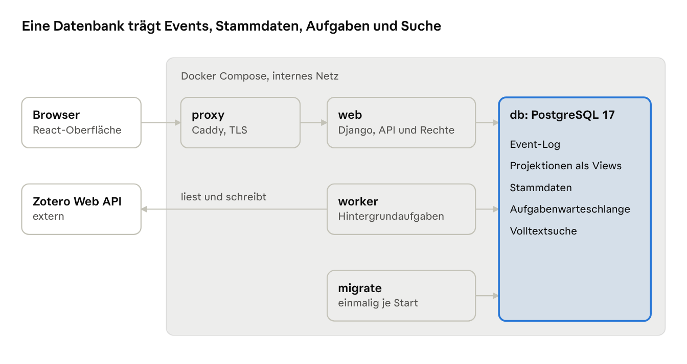

# open-review-tool

Open-Source-Werkzeug für das Screening in Scoping Reviews (JBI) und Systematic Reviews.
Kernideen: ein unveränderliches Event-Log für alle Entscheidungen, ein Stufen-Workflow mit Pilot,
Verblindung, Klärung und Snapshots, und eine Auswertung der Übereinstimmung.

> Status (17.11.2026): lauffähiger erster Stand von Phase 1. Anmeldung, Reviews mit Rollen, Import von RIS
> und BibTeX, Stufen, verblindetes Screening, Konflikte und Konsens, Übereinstimmung, CSV-Export.
> Noch nicht enthalten: Zotero-Anbindung, Volltexte, Suchdokumentation, Reporting, Single Sign-on.



## Schnellstart mit Docker

Voraussetzung: Docker mit dem Compose-Plugin.

```bash
cd deploy
cp .env.example .env                      # ORT_DOMAIN anpassen, für einen Test reicht localhost
mkdir -p secrets && chmod 700 secrets
openssl rand -hex 24 > secrets/db_password
openssl rand -hex 48 > secrets/django_secret_key
chmod 644 secrets/*
docker compose build
docker compose up -d
docker compose exec web python manage.py createsuperuser
```

Danach ist die Anwendung unter `https://<ORT_DOMAIN>` erreichbar. Weitere Konten legt der Administrator
unter `/admin/` an. Betrieb, Sicherung und Aktualisierung beschreibt [`deploy/README.md`](deploy/README.md).

## Aufbau

| Pfad | Inhalt |
| --- | --- |
| `backend/eventcore/` | SQL-Kern als Django-Migrationen: Event-Log mit Hash-Kette, Projektionen, Kennzahlen. `store.py` ist die einzige Schreibstelle |
| `backend/reviews/` | Stammdaten, Import, Fachlogik (`services.py`) und HTTP-Schnittstelle (`api.py`) |
| `backend/tests/` | Tests für Kern, Import und den durchgehenden Ablauf über die API |
| `frontend/` | Oberfläche mit React, TypeScript und Vite |
| `deploy/` | Compose-Datei, Caddyfile, Betriebsanleitung, durchgehender Test und Browsertest |
| `eventlog/` | Referenztests und Lasttest für den SQL-Kern, Konfidenzintervalle in Python |
| `docs/` | Anforderungsanalyse mit Stufenmodell, JBI-Anforderungen und Umsetzungsplan |
| `.github/workflows/ci.yml` | Prüft jeden Push: Tests, Build, Compose-Stack, Browsertest, Wiederherstellung |

Technik: Django 6.1, Django REST Framework, PostgreSQL 17, django-tasks-db für Hintergrundaufgaben,
React 18, Caddy als Proxy. Es gibt keinen Redis und kein Elasticsearch; Warteschlange und Suche liegen in PostgreSQL.

## Wie es geprüft ist

Die Prüfung läuft in GitHub Actions, nicht nur lokal:

- **Backend:** 17 Django-Tests (Kern, Import, Rechte, Verblindung, Ablauf) und 33 Referenztests des SQL-Kerns
  gegen PostgreSQL 17. Die Referenzen sind scikit-learn und publizierte Beispiele.
- **Oberfläche:** Typprüfung und Build.
- **Gesamtsystem:** Das Image wird gebaut, der Compose-Stack startet, dann läuft `deploy/smoke_test.py` durch
  den Proxy: Anmeldung, Import über den Worker, verblindete Abstimmung zweier Personen, Konflikt, Konsens,
  Abschluss mit Snapshot, Prüfung der Hash-Kette.
- **Browser:** `deploy/ui_check.py` bedient die Oberfläche in Chromium bei 390 px Breite, einschließlich
  Tastaturbedienung, und legt Bildschirmfotos als Artefakt ab.
- **Sicherung:** `pg_dump`, Wiederherstellung in eine zweite Datenbank und Prüfung der Hash-Ketten dort.

Nicht geprüft sind bisher: ein öffentliches Zertifikat über Caddy, große Importe (20.000 Einträge) über die
Oberfläche und der Betrieb mit mehreren Worker-Prozessen.

## Lokal entwickeln

```bash
# Backend (PostgreSQL muss laufen; Zugangsdaten über DATABASE_* setzen)
cd backend
pip install -r requirements.txt -r requirements-dev.txt
export DJANGO_DEBUG=1 ORT_TASK_BACKEND=django.tasks.backends.immediate.ImmediateBackend
python manage.py migrate && python manage.py runserver
pytest

# Oberfläche (leitet /api an localhost:8000 weiter)
cd frontend
npm install && npm run dev

# Referenztests des SQL-Kerns (starten eine eigene Wegwerf-Instanz von PostgreSQL 16)
python eventlog/test_projections.py
```

## Abweichungen vom Umsetzungsplan

- **Anmeldung:** vorerst die eingebaute Django-Anmeldung. django-allauth kommt mit Single Sign-on.
- **Dubletten:** exakter Abgleich über DOI oder normalisierten Titel plus Jahr. Der unscharfe Abgleich mit
  `pg_trgm` fehlt noch.
- **Getrennte Datenbankrollen:** noch nicht umgesetzt. Trigger verhindern Ändern, Löschen und Leeren des Event-Logs.
- **Konfidenzintervalle:** in `eventlog/agreement.py` vorhanden und getestet, aber noch nicht in der Oberfläche.
- **Lock-Dateien:** direkte Python-Abhängigkeiten sind festgeschrieben, indirekte und die npm-Pakete noch nicht.

## Offene Entscheidungen

- Team-Server oder Einzelplatz als Hauptfall
- PostgreSQL 17 oder 18
- Reihenfolge der nächsten Pakete: Zotero, Suchdokumentation oder Reporting zuerst
- Peters et al. 2022 und Pollock et al. 2023 (JBI) auswerten

## Lizenz

MIT, siehe `LICENSE`.
