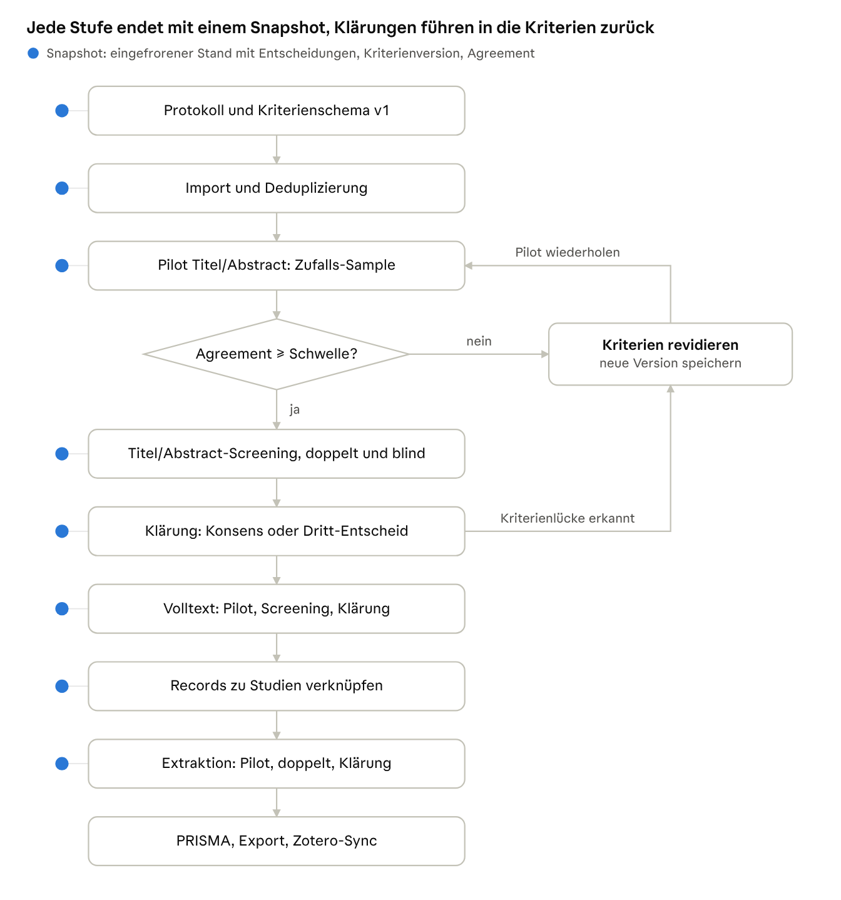
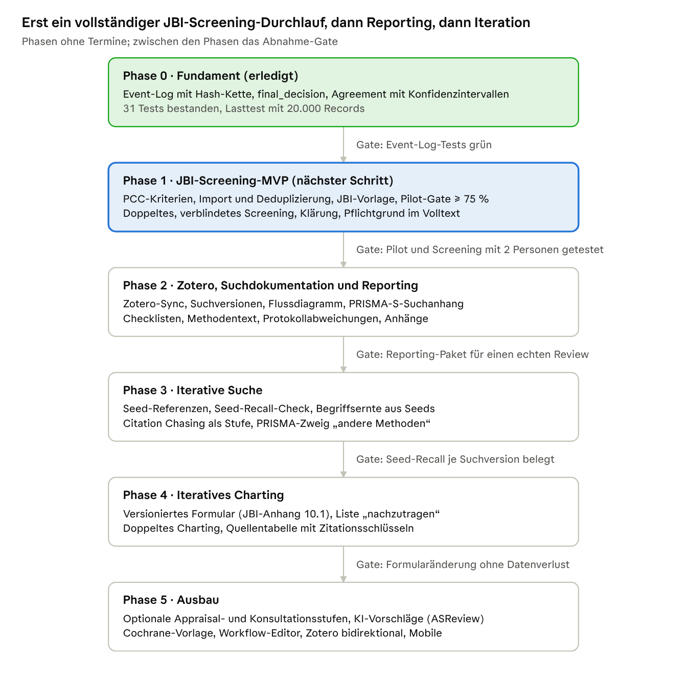

# Rayyan-Funktionsanalyse – Anforderungen für ein Open-Source-Screening-Tool

Nov 17, 2026 · @Dorian

## Zweck und Methode

Diese Analyse beschreibt Rayyans Funktionen als Ausgangspunkt für eine eigene Anforderungsliste (Clean-Room-Ansatz). Grundlage sind ausschließlich öffentliche Quellen: das Rayyan Help Center, Bibliotheks-Guides und ein Cochrane-Abstract. Code, Frontend und API von Rayyan wurden nicht untersucht, weil die AGB das Reverse Engineering auch der „zugrunde liegenden Ideen oder Algorithmen“ untersagen.

Vorbehalt: Die Help-Center-Artikel wurden 2026 teils umgebaut, ältere Bibliotheks-Guides beschreiben eventuell veraltete Oberflächen. Planabhängige Funktionen (Free/Essential/Advanced) ändern sich häufig und sind vor einer Veröffentlichung erneut zu prüfen.

## Team-Kooperation

Rayyan regelt die Zusammenarbeit über fünf Review-Rollen und vier Methoden der Arbeitsteilung. Konflikte löst das Team erst nach dem Entblinden auf ([Roles and Permissions](https://help.rayyan.ai/hc/en-us/articles/46703035602833-Roles-and-Permissions-in-Rayyan), [Organize Screening Work](https://help.rayyan.ai/hc/en-us/articles/46704017851281-How-to-Organize-Screening-Work-Across-Your-Team)).

| Rolle | Rechte (Kurzfassung) | Kosten |
| --- | --- | --- |
| Owner | Volle Kontrolle; als einzige Rolle: Mitglieder einladen, Rollen ändern, Blind-Modus umschalten, Review löschen | – |
| Review Admin | Wie Owner, außer löschen, AI Reviewer starten, andere Admins verwalten, Plan/Seats verwalten | Bezahlter Seat |
| Collaborator | Fast alles, aber nicht löschen, einladen, blind umschalten; Funktionsumfang erbt den Plan des Owners | Bezahlter Seat |
| Reviewer | Screenen, Labels, Gründe, Notizen; kein Upload, Export, Deduplizieren, keine Keyword-Konfiguration | Frei |
| Viewer | Nur lesen (Betreuung, Aufsicht) | Frei |

**Arbeitsteilung (4 Methoden)**

1. Alle screenen alles: zwei oder mehr Personen, Blind-Modus an, danach Konfliktfilter.
2. Data Sampling: zufällige Teilmengen pro Person (Details unter „Zufall und Priorisierung“).
3. Min/Max-Entscheidungsfilter: Ansicht „mindestens/höchstens n Entscheidungen“; ein Datensatz verschwindet, sobald das Ziel erreicht ist. Kein Vorab-Zuweisen nötig, funktioniert auch blind.
4. Label-basiert: Gruppen (z. B. nach Datenbank) per Label zuweisen. Geht nur mit Blind-Modus aus, weil Labels sonst unsichtbar sind.

**Konfliktauflösung:** Der Owner schaltet den Blind-Modus aus und filtert unter „Filter by inclusion“ nach „Conflicts“ ([Resolve Conflicts](https://help.rayyan.ai/hc/en-us/articles/25316026225041)). Für einen Dritt-Entscheider empfiehlt Rayyan ein Sample aus den Konflikten und Labels wie „Conflict – Include“. Ein Bibliotheks-Guide zur Legacy-Version rät, dass danach alle Reviewer ihre Einzelentscheidung an die Teamentscheidung anpassen ([Northwestern](https://libguides.galter.northwestern.edu/rayyan/screen)).

Beobachtung: Eine eigene, getrennt gespeicherte Konsensentscheidung fehlt offenbar. Die ursprünglichen Einzelvoten gehen beim Angleichen verloren, was die Berechnung der Inter-Rater-Reliabilität erschwert. Das ist eine mögliche Verbesserung für das eigene Tool. Unsicher: Die Help-Center-Artikel nennen teils vier, teils fünf Rollen; ältere Guides erwähnen noch eine Rolle „Translator“.

## Blind-Modus

Der Blind-Modus ist ein einziger Schalter pro Review, standardmäßig an und auf allen Plänen verfügbar; er gilt in allen Phasen ([Blind Mode](https://help.rayyan.ai/hc/en-us/articles/17460918624145)). Umschalten darf nur der Owner, auf Enterprise-Plänen auch Enterprise-Admins ([Conflicts FAQ](https://help.rayyan.ai/hc/en-us/articles/34237677089809-Rayyan-Screening-Conflicts-Frequently-Asked-Questions)).

|  | Blind an | Blind aus |
| --- | --- | --- |
| Entscheidungen | Nur die eigenen | Alle Entscheidungen aller Mitglieder |
| Konfliktfilter | Nicht verfügbar | Verfügbar |
| Labels und Gründe | Nur eigene sichtbar und bearbeitbar | Alle sichtbar; alle außer Viewern können fremde entfernen |
| Export | Enthält nur die eigenen Entscheidungen | Enthält alle Entscheidungen |
| Relevanz-Ranking | Gleich: Vorhersagen nutzen die gepoolten Entscheidungen aller | Gleich |

**Empfohlener Ablauf pro Phase** (Titel/Abstract, Volltext, Extraktion, Risk of Bias):

1. Blind an: alle arbeiten unabhängig.
2. Owner schaltet aus und löst Konflikte bzw. „Unmatched Answers“ (Extraktion).
3. Eingeschlossene Datensätze in die nächste Phase verschieben, solange noch aus.
4. Wieder einschalten, bevor die nächste Phase beginnt.

In der Datenextraktion markiert Rayyan bei ausgeschaltetem Blind-Modus abweichende Antworten automatisch orange als „Unmatched Answers“ ([Blind Mode in Extraction](https://help.rayyan.ai/hc/en-us/articles/46033232644369)).

Beobachtung: Der Modus ist global. Wer zur Fortschrittskontrolle entblindet, entblindet alle gleichzeitig. Ein feineres Modell wäre, pro Datensatz erst nach Abschluss aller Voten freizugeben oder Admins einseitig sehen zu lassen. Ob Rayyan Gründe und Notizen gleich behandelt wie Labels, ist nicht eindeutig dokumentiert.

## Keywords und Highlighting

Rayyan führt zwei Keyword-Listen, „Keywords for Include“ und „Keywords for Exclude“. Treffer werden in Titel, Abstract und Publikationstyp markiert, Include grün, Exclude rot ([Facets](https://help.rayyan.ai/hc/en-us/articles/17460403631633), [Filter, Search, Sort](https://help.rayyan.ai/hc/en-us/articles/45737285564561-How-to-Filter-Search-and-Sort-References-in-Rayyan)).

- **Vorbelegung:** Beide Listen sind vorbefüllt mit Begriffen nach Mahmić-Kaknjo (2015), die mit RCTs und CCTs assoziiert sind. Laut Rayyan halbiert das Highlighting die Screening-Zeit ungefähr; das ist eine Herstellerangabe, die ich nicht unabhängig geprüft habe.
- **Pflege:** Begriffe kommagetrennt über „+“ im Filterpanel hinzufügen, per Checkbox und Papierkorb löschen. Reviewer dürfen die Listen nicht ändern ([UFS Guide](https://ufs.libguides.com/digitalscholar/rayyan)).
- **Doppelfunktion:** Keywords sind zugleich Filter-Facetten, man kann also nach Datensätzen mit bestimmten Treffern filtern.
- **PICO-Highlights:** Ein separater Schalter markiert KI-erkannte Population-, Intervention- und Outcome-Begriffe im Abstract ([Cochrane-Abstract 2024](https://abstracts.cochrane.org/2024-prague-global-evidence-summit/exploring-rayyans-features-study-selection-systematic-reviews)). Nur in den Plänen Advanced und Institutional.

Beobachtung: Die RCT-lastigen Standardlisten passen schlecht zu Scoping Reviews oder Informatik-Themen. Ein eigenes Tool sollte Keyword-Sets pro Review aus den Einschlusskriterien oder dem Suchstring ableiten und als versionierte Konfiguration speichern.

## Filter, Suche und Sortierung

Das Filterpanel kombiniert Facetten mit fester Logik: innerhalb einer Facette ODER, zwischen Facetten UND. Filtern und Sortieren löschen nie Daten ([Filter, Search, Sort](https://help.rayyan.ai/hc/en-us/articles/45737285564561-How-to-Filter-Search-and-Sort-References-in-Rayyan)).

**Entscheidungsfilter** (Dropdown über der Liste): Alle · Undecided (Standard) · Maybe (mindestens eine Person) · Included (alle Include) · Excluded (alle Exclude) · Conflict (nur bei Blind aus).

| Facette | Filtert nach | Verfügbarkeit |
| --- | --- | --- |
| Keywords for Include / Exclude | Keyword-Treffer | Immer, vorbefüllt |
| Min/Max Member Decisions | Anzahl abgegebener Voten | Immer |
| Labels | Labels, auch vom AI Reviewer | Sobald ein Label existiert |
| Exclusion Reasons | Ausschlussgrund | Sobald ein Grund existiert |
| Search Methods | Importquelle (z. B. Pubmed.csv) | Nach Import |
| Sampled Data | Zugehörigkeit zu einem Sample | Alle Pläne; Free/Essential nur 1 Sample |
| PICO (P/I/O) | KI-erkannte PICO-Begriffe | Advanced, Institutional |
| Ratings | KI-Relevanzwert | Advanced, Institutional |
| Full Text PDF | PDF angehängt ja/nein | Manuell aktivieren |
| Publication Types | z. B. RCT, Review, Case Report | Wenn Metadaten vorhanden |
| Topics | Per NLP/ML erkannte Themen | Wenn Metadaten vorhanden |
| Journals, Authors, Years | Bibliografische Felder | Manuell aktivieren |
| Abstract Language, Main Language | Sprache | Manuell aktivieren |

**Suche:** Volltext über alle Felder (Titel, Abstract, ID, Autoren, Journal), live beim Tippen und mit aktiven Filtern kombinierbar. Bool’sche Operatoren werden nicht dokumentiert.

**Sortierung:** Rating (wahrscheinlich ein-/ausschließen), Autor, Datum, Titel.

Beobachtung: „Search Methods“ als Facette ist für PRISMA-S wichtig, denn so bleibt die Herkunft pro Datenbank nachvollziehbar. Gespeicherte Filteransichten werden nicht erwähnt.

## Zufall, Sampling und Priorisierung

Rayyan bietet drei Mechanismen für Reihenfolge und Auswahl: Data Sampling (inklusive Zufall), Relevance Ranking mit 5 Stufen und den LLM-basierten AI Reviewer.

**Data Sampling** ([How to Use Data Sampling](https://help.rayyan.ai/hc/en-us/articles/21714572837521-How-to-Use-Data-Sampling-in-Rayyan))

- Quelle: alle Referenzen oder die aktuell gefilterte Menge.
- Methoden: Randomized (empfohlen), System ID, Titel, Publikationsdatum, Autoren, Rating.
- Größe: Prozent oder Anzahl, beide Werte sind gekoppelt.
- Samples sind benannt und erscheinen als Facette „Sampled Data“. Sie beschränken keinen Zugriff, der Owner muss die Zuteilung selbst kommunizieren.
- Einsatzzwecke laut Rayyan: Arbeitsteilung, Pilot-Screening zur Kalibrierung der Kriterien (alle screenen dasselbe Zufalls-Sample, dann entblinden und Konkordanz prüfen), Training des Klassifikators ([Rayyan-Blog](https://blog.rayyan.ai/2025/06/27/random-sampling-in-systematic-literature-reviews-as-a-best-practice)).

**Relevance Ranking** ([How to Use Relevance Ranking](https://help.rayyan.ai/hc/en-us/articles/45819983751569-How-to-Use-Relevance-Ranking-in-Rayyan))

- Lernt aus den gepoolten Entscheidungen des Teams und ordnet unentschiedene Datensätze in 5 Stufen ein, von „most likely to exclude“ bis „most likely to include“.
- Mindestens 50 Entscheidungen, davon je mindestens 5 Include und 5 Exclude; die Berechnung wird manuell über „Compute Ratings“ gestartet.
- Ratings sind nur Vorschläge, keine Entscheidungen. Inkonsistente Teamvoten führen zu „No Recommendations“.
- Das ursprüngliche Verfahren ist publiziert: ein SVM-basiertes Ensemble, das auf eine 5-Sterne-Skala abbildet ([Saha et al., arXiv 1610.00192](https://arxiv.org/abs/1610.00192)). Ob die heutige Produktivversion noch so arbeitet, ist nicht dokumentiert.

**AI Reviewer / ResearchPilot:** Ein LLM-basierter Reviewer, der die hinterlegten Screening-Kriterien direkt nutzt und Labels vorschlägt. Nur in Institutional-Plänen ([Screening Criteria](https://help.rayyan.ai/hc/en-us/articles/43743979403921)).

Beobachtung: Ranking und Sampling lassen sich vollständig aus offenen Quellen nachbauen (Paper, ASReview als Active-Learning-Referenz). Fehlende Funktionen bei Rayyan: ein dokumentierter Random-Seed für reproduzierbare Samples und Abbruchkriterien (Stopping Rules) für priorisiertes Screening.

## Ausschlussgründe und Labels

Rayyan trennt zwei Annotationsarten: Ausschlussgründe fließen automatisch ins PRISMA-Diagramm, Labels dienen nur dem Organisieren ([Labels and Exclusion Reasons](https://help.rayyan.ai/hc/en-us/articles/45706942438289-How-to-Use-Labels-and-Exclusion-Reasons-in-Rayyan)).

|  | Ausschlussgründe | Labels |
| --- | --- | --- |
| Zweck | Begründung eines Ausschlusses (z. B. „Wrong population“) | Freies Taggen und Gruppieren, auch Einschlussgründe |
| In PRISMA | Ja, automatisch | Nein |
| Filterbar | Ja | Ja |
| Phasen | Titel/Abstract und Volltext | Titel/Abstract und Volltext |
| Vorgaben | Vordefinierte Liste, nicht editierbar; eigene Gründe bleiben für das Review erhalten | Frei |
| Bei Blind an | Nur eigene sichtbar und bearbeitbar | Nur eigene sichtbar und bearbeitbar |

- **Bedienung:** Tastenkürzel I (Include), M (Maybe), E (Exclude), R (Exclude mit Grund) ([Quick Start Guide](https://webupload.gazi.edu.tr/upload/13/2025/11/21/b1dec39c-8628-44ca-8f35-558ba4e46a16-rayyans-quick-start-guide-1025-v10.pdf)). Nach einer Entscheidung springt Rayyan automatisch zum nächsten Datensatz und speichert sofort.
- **Massenbearbeitung:** Über Multi-Select lassen sich Labels und Gründe für viele Datensätze gleichzeitig setzen oder entfernen.
- **Notizen:** Freitext pro Datensatz, auch für Reviewer.
- **Mehrere Gründe:** Die Oberfläche arbeitet mit Checkboxen, mehrere Gründe pro Datensatz scheinen also möglich (nicht ausdrücklich dokumentiert). Ein Legacy-Guide empfiehlt, den Hauptgrund zu wählen ([Northwestern](https://libguides.galter.northwestern.edu/rayyan/screen)).

Beobachtung: PRISMA verlangt pro ausgeschlossenem Volltext genau einen Grund. Rayyan erzwingt das nicht, und Gründe aus Titel/Abstract- und Volltext-Phase werden im Diagramm zusammengefasst (siehe nächster Abschnitt). Ein eigenes Tool sollte Gründe als vorab definiertes, versioniertes Kriterienschema mit Pflichtfeld „primärer Grund“ in der Volltextphase führen.

## Visualisierungen und Reporting

Die wichtigste Visualisierung ist ein PRISMA-2020-Flussdiagramm, das Rayyan nur teilweise selbst befüllt. Es ist ab dem Essential-Plan verfügbar und kann als PDF, PNG, SVG oder interaktives HTML exportiert werden ([PRISMA in Rayyan](https://help.rayyan.ai/hc/en-us/articles/45959279429649)).

| PRISMA-Feld | Befüllung |
| --- | --- |
| Datenbanken, Register (n) | Manuell |
| Entfernte Dubletten | Automatisch |
| Durch Automatisierung als ungeeignet markiert | Manuell, von Rayyan nicht unterstützt |
| Aus anderen Gründen entfernt | Manuell |
| Gescreente Records, ausgeschlossene Records | Automatisch |
| Zur Beschaffung angeforderte Reports | Automatisch |
| Nicht beschaffte Reports, auf Eignung geprüfte Reports | Manuell |
| Ausgeschlossene Reports mit Gründen | Automatisch aus den Ausschlussgründen |
| Eingeschlossene Studien und Reports | Manuell |

Einschränkungen: Manuelle Änderungen werden nicht gespeichert und gehen beim Schließen verloren. Gründe aus beiden Screening-Phasen werden zusammengefasst und müssen bei Bedarf von Hand getrennt werden.

**Weitere Kennzahlen** ([How to Screen References](https://help.rayyan.ai/hc/en-us/articles/45703234075281-How-to-Screen-References-in-Rayyan)):

- Screening Summary: Team-Übereinstimmung in Prozent und Anzahl offener Konflikte.
- Team Progress: pro Mitglied Zeitaufwand, Anzahl Sitzungen, Entscheidungen und Fortschritt in Prozent.
- Farbige Entscheidungs-Chips pro Datensatz in der Liste.

Beobachtung: Dokumentiert ist nur die prozentuale Übereinstimmung. Cohen’s/Fleiss’ Kappa, Konfusionsmatrizen pro Reviewer-Paar oder Auswertungen nach Kriterium habe ich in der Rayyan-Doku nicht gefunden. Das wäre ein klarer Mehrwert, etwa für den Methodenteil einer Publikation.

## Import, Export, Dubletten und Zotero

Rayyan bindet Zotero nur über Dateien an: Zotero exportiert RIS oder BibTeX, Rayyan importiert die Datei, und am Ende geht ein RIS-Export zurück ([Import from Major Databases](https://help.rayyan.ai/hc/en-us/articles/45589301098769-How-to-Import-References-from-Major-Databases), [Zotero → Rayyan](https://help.rayyan.ai/hc/en-us/articles/6079674651921-How-do-I-import-articles-from-Zotero-to-Rayyan)). Eine Direktanbindung bewirbt Rayyan nur für Mendeley ([rayyan.ai](https://rayyan.ai/)).

- **Importformate:** RIS, CSV, BibTeX, EndNote (.enw), PubMed (XML/nbib); bis zu 10 Dateien gleichzeitig ([Funktionsübersicht](https://help.rayyan.ai/hc/en-us/articles/22697630697617)). BibTeX aus Google Scholar enthält keine Abstracts. McGill berichtet, dass RIS-Importe aus mehreren Datenbanken scheitern ([McGill](https://libraryguides.mcgill.ca/rayyan/gettingstarted)).
- **Dubletten:** Erkennung exakter und ähnlicher Datensätze auf allen Plänen. Der Auto-Resolver löst Paare mit mindestens 95 % Ähnlichkeit per Klick auf (kostenpflichtig). Die Enterprise-Version bewirbt regelbasierte, reproduzierbare Rule-Sets ([Enterprise](https://www.rayyan.ai/enterprise)).
- **Export:** RIS (RefMan) für Literaturverwaltungen, CSV für Extraktionsdaten. Bei Blind an enthält der Export nur die eigenen Entscheidungen.
- **Herkunft:** Die Facette „Search Methods“ merkt sich die Importdatei je Datensatz.

Beobachtung: Genau hier liegt der Kern des eigenen Projekts. Ein bidirektionaler Zotero-Sync könnte Entscheidungen, Gründe und Labels als Tags oder Collections zurückschreiben (lokale API ab Zotero 10 oder Web API für Gruppenbibliotheken). Dann entfällt der Roundtrip über Dateien, und die Zotero-Item-Keys bleiben stabil.

## Weitere Funktionen

Rayyan ist inzwischen eine Pipeline mit vier Phasen: Titel/Abstract-Screening, Volltext-Screening, Datenextraktion und Risk of Bias. Viele neuere Funktionen gibt es nur in höheren Plänen ([How to Screen References](https://help.rayyan.ai/hc/en-us/articles/45703234075281-How-to-Screen-References-in-Rayyan), [Funktionsübersicht](https://help.rayyan.ai/hc/en-us/articles/22697630697617)).

| Funktion | Kurzbeschreibung | Verfügbarkeit |
| --- | --- | --- |
| Screening-Kriterien | Ein- und Ausschlusskriterien im Review hinterlegen; der AI Reviewer nutzt sie direkt | Alle; KI-Nutzung nur Institutional |
| Volltext-Screening | PDFs hochladen, automatisch zuordnen (Auto-Match), gleiche Entscheidungslogik wie bei Titel/Abstract | Alle; Auto-Match laut Marketing |
| Datenextraktion | Eigene Formulare und Tabellen, Pflichtfelder, Blind-Extraktion mit „Unmatched Answers“, CSV-Export | Laut Rayyan-Blog 2025 eingeführt |
| Risk of Bias | Integrierte Appraisal-Tools (laut Drittquelle RoB 2, ROBINS-I, Newcastle-Ottawa) | Neu 2026; Plan unklar |
| ResearchPilot | AI Reviewer, AI Analyzer, Auto-Extraktion, Chat mit dem Korpus | Institutional |
| Mobile App | iOS/Android, offline screenen, später synchronisieren | Alle; Free auf 100 Entscheidungen begrenzt |
| API | Programmatischer Zugriff | Enterprise |
| SSO, Teams | Organisationsweite Verwaltung, Workspace-Rollen | Business/Enterprise |

Quellen zu Extraktion und RoB: [Rayyan-Blog Data Extraction](https://www.rayyan.ai/post/rayyan-data-extraction-from-manual-to-fully-automated-insights-ek3qo), [Enterprise](https://www.rayyan.ai/enterprise), [Paperguide-Vergleich](https://paperguide.ai/blog/paperguide-vs-rayyan/) (Drittquelle, kommerziell, mit Vorsicht zu lesen).

Unsicher: Die Planzuordnung ändert sich laufend, und Preisseite und Help Center widersprechen sich teilweise (z. B. Anzahl aktiver Reviews im Free-Plan: 3 laut CASRAI, 9 laut aktueller Preisseite). Mein Vorschlag: Diese Phasen erst nach dem Screening-Kern als eigene Ausbaustufe planen.

## Ableitung: Anforderungen und Abdeckung durch Open-Source-Basen

Der Kern, den keine Basis fertig mitbringt, besteht aus verblindetem Doppel-Screening mit sauberer Konsensentscheidung, dem Zotero-Sync und einem automatischen PRISMA-Diagramm. Argilla deckt die Annotationsgrundlagen ab, wird aber laut Extralit von den ursprünglichen Autoren nicht mehr aktiv weiterentwickelt ([Extralit](https://github.com/Extralit/extralit)). Das ist das größte Risiko einer Argilla-Basis.

| Anforderung | Priorität | Rayyan-Vorbild | Abdeckung durch Basis |
| --- | --- | --- | --- |
| Bidirektionaler Zotero-Sync (Collections, Tags, stabile Item-Keys) | Must | Nur Datei-Roundtrip | Neu; pyzotero als Client |
| Unabhängiges Doppel-Screening mit Blind-Modus | Must | Globaler Blind-Schalter | Argilla: Mindestzahl Antworten pro Datensatz (`min_submitted`) ([Doku](https://docs.argilla.io/dev/how_to_guides/distribution/)); Sichtbarkeit fremder Antworten zu prüfen |
| Konfliktansicht und getrennte Konsensentscheidung, Originalvoten bleiben erhalten | Must | Angleichen der Einzelvoten | Neu |
| Include/Maybe/Exclude mit Gründen aus versioniertem Kriterienschema, Pflicht-Primärgrund im Volltext | Must | Vordefinierte und eigene Gründe | Argilla: Label-/Multi-Label-Fragen (teilweise) |
| Labels und Notizen pro Datensatz | Must | Labels, Notizen | Argilla: Multi-Label- und Textfragen |
| Rollen Owner, Admin, Reviewer, Viewer | Must | 5 Rollen | Argilla: Owner, Admin, Annotator (teilweise) |
| Import RIS/BibTeX/PubMed mit Deduplizierungsprotokoll | Must | Import, Auto-Resolver ab 95 % | Neu; vorhandene Parser nutzen (z. B. [synthesisr](https://cloud.r-project.org/web/packages/synthesisr/refman/synthesisr.html)) |
| Facettenfilter (Entscheidung, Grund, Label, Quelle, Jahr, Journal, Sample) und Volltextsuche | Must | Rund 20 Facetten | Argilla: Metadaten-Filter und Suche (teilweise) |
| Keyword-Highlighting Include/Exclude, pro Review konfigurierbar | Should | Grün/rot, RCT-Standardlisten | Neu (Argilla hebt nur Suchtreffer hervor) |
| PRISMA-2020-Diagramm automatisch, Gründe nach Phase getrennt, Zählung pro Datenbank | Must | Teilautomatisch, Gründe zusammengefasst | Neu |
| Zufalls-Samples mit Seed, Pilot-/Kalibrierungsrunde | Should | Data Sampling ohne Seed | Neu (geringer Aufwand) |
| Agreement-Statistik (Prozent, Cohen’s/Fleiss’ Kappa) pro Phase | Should | Nur Prozent | Neu |
| Priorisierung per Active Learning mit Stopping Rule | Should | 5-Stufen-Ranking | ASReview als Modell-Backend (Apache 2.0) ([CASRAI](https://casrai.org/guides/asreview)) |
| Audit-Log aller Entscheidungen | Should | Nicht dokumentiert | Argilla speichert Antworten mit Status; Log neu |
| Volltext-Screening mit PDFs | Could | PDF-Upload, Auto-Match | Extralit: PDF-OCR und Tabellenerkennung |
| Datenextraktion, Risk of Bias | Could | Formulare, RoB-Tools | Extralit: schemabasierte Extraktion |
| Mobile/offline | Could | Apps mit Offline-Sync | Nicht abgedeckt |

Zur Konkurrenz: ASReview LAB v2 bietet seit Mai 2025 Crowd-Screening, bei dem mehrere Personen mit einem gemeinsamen Modell arbeiten ([ASReview v2, Patterns 2025](https://pmc.ncbi.nlm.nih.gov/articles/PMC12416088)). Ob damit verblindetes Doppel-Screening mit Konfliktauflösung möglich ist, habe ich nicht verifiziert. Das sollte vor dem Projektstart geklärt werden, weil es die Daseinsberechtigung des eigenen Tools direkt betrifft.

## Stufenmodell: Methodische Grundlage

Rayyan bildet nur vier feste Phasen ab. Die Leitlinien beschreiben dagegen einen Prozess mit Pilot-Schleifen, Kriterien-Revisionen und Klärungsrunden, und jede dieser Runden erzeugt einen Zwischenstand, der dokumentiert werden muss.

| Vorgabe | Inhalt | Konsequenz fürs Tool |
| --- | --- | --- |
| JBI-Pilot Screening ([JBI Manual 10.2.6](https://jbi-global.atlassian.net/wiki/spaces/MANUAL/pages/355862749/10.2.6+Source+of+evidence+selection)) | Zufalls-Sample von 25 Titeln/Abstracts; das ganze Team screent; Diskrepanzen besprechen, Kriterien und Erläuterungsdokument anpassen; regulär erst ab ≥ 75 % Übereinstimmung | Pilot als eigene Stufe mit Gate (Schwellenwert) und Rückschleife |
| JBI/Cochrane Doppel-Screening | Zwei oder mehr Personen unabhängig in beiden Screening-Phasen; Konsens oder Dritt-Entscheid ([JBI](https://jbi-global.atlassian.net/wiki/spaces/MANUAL/pages/355862749/10.2.6+Source+of+evidence+selection)); Klärungsverfahren vorab festlegen ([MECIR C39](https://www.cochrane.org/de/authors/handbooks-and-manuals/mecir-manual/standards-conduct-new-cochrane-intervention-reviews-c1-c75/performing-review-c24-c75/selecting-studies-include-review-c39-c42)) | Klärungsregel pro Stufe konfigurierbar |
| Cochrane Training | Pilot an wenigen Arbeiten; Diskussionen können Lücken in den Kriterien aufdecken ([Cochrane-Folien 2022](https://resources.cochrane.org/sites/resources.cochrane.org/files/uploads/Trainers/ATM%20Selecting%20studies_Jul2022.pdf)) | Kriterien versionieren, Disput-Ergebnisse in Kriterien zurückführen |
| MECIR C40/C41 | Mehrere Records einer Studie zuordnen; Ein- und Ausschlusslisten auf Studien-, nicht auf Record-Ebene ([MECIR](https://www.cochrane.org/de/authors/handbooks-and-manuals/mecir-manual/standards-conduct-new-cochrane-intervention-reviews-c1-c75/performing-review-c24-c75/selecting-studies-include-review-c39-c42)) | Eigene Stufe „Record → Studie verknüpfen“ |
| Pilot Extraktion | JBI empfiehlt mindestens 2–3 Artikel, oft sind 5 oder mehr nötig ([NIH Library](https://www.nihlibrary.nih.gov/services/evidence-synthesis/select-collect-synthesize/data_collection)) | Pilot-Stufe auch vor Extraktion |

Vorbild für Konfigurierbarkeit ist DistillerSR. Dort werden Workflows aus „Levels“ und Formularen frei zusammengesetzt und als Vorlagen wiederverwendet ([DistillerSR](https://blog.distillersr.com/products/distillersr-systematic-review-software), [Workflow-Konfiguration](https://www.distillersr.com/?p=201)). Außerdem lässt sich je Level einstellen, wie Konflikte behandelt werden, etwa liberales Screening, bei dem ein Include genügt ([Agreement Settings](https://distillersr.com/?p=11341)). DistillerSR ist proprietär und richtet sich an Unternehmen. Ein offenes Tool mit diesem Funktionsumfang wäre also eine echte Lücke, das habe ich aber nicht systematisch geprüft.

## Vorschlag: Standard-Workflow als Vorlage



Das ist eine Vorlage, kein festes Modell: Jede Stufe, jedes Gate und jede Rückschleife soll pro Review konfigurierbar sein. Die Schwelle am Gate folgt der JBI-Empfehlung (≥ 75 %) und lässt sich anpassen. Die Volltext- und Extraktionsstufen haben intern dieselbe Pilot-Gate-Logik wie Titel/Abstract.

## Anforderungen: Konfigurierbarer Workflow und Zwischenstände

Aus dem Stufenmodell folgen zwei Must-Anforderungen, die Rayyan nicht abdeckt. Erstens ein Workflow aus konfigurierbaren Stufen und Gates. Zweitens ein unveränderliches Entscheidungsprotokoll mit benannten Snapshots, damit Pilot-, Disput- und Klärungsstände erhalten bleiben statt überschrieben zu werden. Die Bausteine unten sind mein Architekturvorschlag und nicht aus einer Quelle übernommen.

| Baustein | Was er leistet | Umsetzungsidee |
| --- | --- | --- |
| Stufendefinition | Typ (Pilot, Screening, Klärung, Verknüpfung, Extraktion, Report), Eingangsmenge, Anzahl Reviewer, Blindheit, Klärungsregel (Konsens, Dritt-Entscheid, liberal) | Workflow als versionierte JSON/YAML-Vorlage; mitgelieferte Vorlagen für Systematic Review (Cochrane) und Scoping Review (JBI) |
| Gate | Bedingung für den Übergang, z. B. Agreement ≥ Schwelle, alle Konflikte gelöst, Mindestzahl Voten | Blockiert den Übergang; der Owner kann mit Begründung übersteuern, das wird protokolliert |
| Versioniertes Kriterienschema | Jede Entscheidung verweist auf die Kriterienversion, unter der sie fiel | Bei einer Revision wählbar: betroffene Records erneut vorlegen oder bestehende Voten behalten |
| Entscheidungsprotokoll | Jedes Votum ist ein Ereignis (Person, Zeit, Stufe, Kriterienversion, Entscheidung, Grund); der Konsens ist ein eigenes Ereignis | Nur anhängen, nie überschreiben (Event-Log); der aktuelle Stand wird daraus berechnet |
| Snapshot | Eingefrorener, benannter Stand am Ende einer Stufe oder auf Knopfdruck: Mengen, Voten, Agreement, Kriterienversion | Prüfsumme über den Stand; Export als Datei, z. B. zur Ablage bei OSF; Grundlage für PRISMA-Zahlen und Methodenteil |
| Rücksprung | Eine wiederholte Stufe ist eine neue Instanz („Pilot, Runde 2“) | Runden sind vergleichbar, etwa Agreement Runde 1 gegenüber Runde 2 |
| Disput-Thread | Diskussion pro Datensatz mit Ergebnis | Ergebnis kann als Erläuterung ins Kriterienschema übernommen werden |

Kritische Einschätzung:

- Ein frei editierbarer Workflow-Designer (à la BPMN) ist aufwendig und für die meisten Teams überdimensioniert. Für ein MVP reichen Vorlagen mit wenigen Parametern (Stufen an/aus, Reviewerzahl, Schwelle, Klärungsregel); einen Editor erst bei nachgewiesenem Bedarf.
- Ein Event-Log macht die Inter-Rater-Statistik pro Runde und Kriterienversion überhaupt erst sauber berechenbar. Die Gegenseite: mehr Speicher, und die Abfragelogik wird komplexer.
- Argilla bildet dieses Modell nicht ab: Antworten haben dort einen Status, aber keine Stufen, Runden oder Kriterienversionen. Diese Schicht wäre in jedem Fall eine Eigenentwicklung, was für eine schlanke eigene Datenhaltung statt eines Argilla-Forks spricht. Die Argilla-Doku zu Workflows habe ich dafür allerdings nicht vollständig geprüft.

## Anforderungsquelle: JBI-Scoping-Review-Prozess

Der JBI-Prozess für Scoping Reviews stellt Anforderungen, die Rayyan kaum abdeckt: Suche und Extraktion sind ausdrücklich iterativ, Quellen sind heterogen (auch graue Literatur und Policy-Dokumente), und Critical Appraisal ist optional. Grundlage ist das JBI Manual, Kapitel 10 (2024), mit den Leitlinien von Peters et al. 2020. Der JBI-Rahmen erweitert die fünf Städien von Arksey und O’Malley (2005) samt optionaler Konsultation auf neun Schritte ([JBI 10.1.3](https://jbi-global.atlassian.net/wiki/spaces/MANUAL/pages/355862599/10.1.3+The+scoping+review+framework), [Peters et al. 2020](https://pubmed.ncbi.nlm.nih.gov/33038124/)).

| JBI-/PRISMA-ScR-Vorgabe | Quelle | Anforderung an das Tool | Stand im Entwurf |
| --- | --- | --- | --- |
| Dreistufige Suche: erst begrenzte Suche in mindestens zwei Datenbanken, dann Textwörter und Index-Terme aus Titel/Abstract analysieren, dann Vollsuche, dann Referenzlisten | [JBI 10.2.5](https://jbi-global.atlassian.net/wiki/spaces/MANUAL/pages/355862729/10.2.5+Search+Strategy) | Stufe „Explorative Suche“: Seed-Referenzen markieren, aus ihnen Begriffe und MeSH-Terme auszählen, Suchstrings versionieren | neu |
| Iterative Vollsuche, geprüft daran, ob die Seed-Referenzen gefunden werden | [JBI 3-Step Search](https://jbi-global.atlassian.net/wiki/x/F4DgJg) | Seed-Recall-Check: Anteil der Seed-Referenzen in jedem neuen Import; jede Suchversion als eigenes Ereignis | neu |
| Referenzlisten der identifizierten Quellen durchsuchen | [JBI 10.2.5](https://jbi-global.atlassian.net/wiki/spaces/MANUAL/pages/355862729/10.2.5+Search+Strategy) | Stufe „Citation Chasing“; Herkunft als „andere Methode“ für den PRISMA-Zweig „other sources“ | neu |
| Breite Quellenarten (Forschung, graue Literatur, Policy) | [Peters et al. 2020](https://rgu-repository.worktribe.com/output/979072) | Quellentyp als Pflichtfeld; Zotero-Itemtypen übernehmen statt nur Zeitschriftenartikel | teilweise (Zotero-Sync) |
| Auswahl durch mindestens zwei Personen unabhängig, Pilot mit 25 Records und ≥ 75 % | [JBI 10.2.6](https://jbi-global.atlassian.net/wiki/spaces/MANUAL/pages/355862749/10.2.6+Source+of+evidence+selection) | Pilot-Gate, Doppel-Screening, Klärungsregel | abgedeckt |
| Ausgeschlossene Volltexte mit Grund im Anhang berichten | [JBI 10.2.7](https://jbi-global.atlassian.net/wiki/spaces/MANUAL/pages/355862769/10.2.7+Data+extraction) | Export „ausgeschlossene Volltexte mit Grund und Zitation“ | neu (aus `final_decision` ableitbar) |
| Charting ist iterativ, die Tabelle wird laufend ergänzt; Pilot durch mindestens zwei Personen; JBI-Vorlage in Anhang 10.1 | [JBI 10.2.9](https://jbi-global.atlassian.net/wiki/x/8Qg2FQ) | Versioniertes Charting-Formular; kommt ein Feld hinzu, werden bereits bearbeitete Quellen als „nachzutragen“ markiert; JBI-Vorlage als Startformular | neu |
| Charting-Methode berichten: kalibrierte bzw. getestete Formulare, unabhängig oder doppelt | [PRISMA-ScR Item 10](https://pmc.ncbi.nlm.nih.gov/articles/PMC8590133/table/Tab3) | Charting mit Blind-Modus und Agreement wie beim Screening; Formularversion pro Wert | teilweise (Event-Log trägt das) |
| Critical Appraisal nur „if done“, mit Begründung | [PRISMA-ScR Item 12](https://pmc.ncbi.nlm.nih.gov/articles/PMC8590133/table/Tab3) | RoB-Stufe im Workflow optional; ist sie aktiv, wird ein Begründungsfeld Pflicht | abgedeckt durch konfigurierbaren Workflow |
| Zahlen pro Stufe mit Ausschlussgründen, idealerweise als Flussdiagramm | [PRISMA-ScR Item 14](https://caregiving.education.wisc.edu/wp-content/uploads/2025/11/PAPER.SUPPLEMENTAL.prisma5.12.25.pdf) | `prisma_counts` mit der Terminologie „sources of evidence“ | offen (Projektion geplant) |
| Merkmale jeder Quelle mit Zitation darstellen | PRISMA-ScR Item 15 (ebd.) | Export der Charting-Tabelle mit Zitationsschlüsseln aus Zotero | neu, passt zum Zotero-Sync |
| Angeben, ob Automatisierung bei der Auswahl genutzt wurde | [JBI-Update zu PRISMA 2020](https://jbi-global.atlassian.net/wiki/spaces/MANUAL/pages/355863360) | KI-Vorschläge als eigene Ereignisse mit Akteurstyp „automation“, getrennt von menschlichen Voten | neu |
| Optionale Konsultationsphase (Stakeholder) | [JBI 10.1.3](https://jbi-global.atlassian.net/wiki/spaces/MANUAL/pages/355862599/10.1.3+The+scoping+review+framework) | Optionale Stufe „Konsultation“ mit Notizen und Bezug zu Quellen | neu, über Workflow-Vorlage |

**Neue Ereignistypen** für den Katalog (Entwurf): `SearchVersionPublished` (Datenbank, Suchstring, Datum, Vorgängerversion), `SeedReferenceMarked`, `ChartingFormVersionPublished`, `ChartingValueRecorded` (Quelle, Feld, Wert, Formularversion), `ConsultationNoteAdded`, `AutomationSuggestionRecorded` (Modell, Version, Vorschlag, Konfidenz).

**Konsequenzen für das Design:**

- Das Kriterienschema muss PCC (Population, Concept, Context) unterstützen und nicht nur PICO. Rayyans PICO-Highlighting und RCT-Standardlisten passen für Scoping Reviews nicht.
- Die JBI-Vorlage für Scoping Reviews sollte die erste mitgelieferte Workflow-Vorlage sein. Sie unterscheidet sich vom Cochrane-Ablauf durch die explorative Suche, Citation Chasing, iteratives Charting, optionale Appraisal- und Konsultationsstufen.
- Iteratives Charting ist das stärkste Argument für das Event-Log: Jeder Wert verweist auf seine Formularversion, also lässt sich jederzeit zeigen, welche Quellen nach einer Formularänderung noch nachgetragen werden müssen.

Nicht geprüft: die Leitlinie zur Protokollerstellung (Peters et al. 2022) und die Empfehlungen zur Extraktion und Ergebnisdarstellung (Pollock et al. 2023, [JBI Evid Synth 21(3)](https://digital.library.adelaide.edu.au/items/bb22fb54-2480-4c38-b2c2-dd73d2b0fe2c/full)). Beide sind als Interim Guidance gelistet und könnten weitere Anforderungen liefern, vor allem an das Protokoll-Modul und die Ergebnisdarstellung.

## Umsetzungsplan



Jede Phase endet mit einem prüfbaren Gate. Das wichtigste ist das Gate nach Phase 2: ein vollständiges Reporting-Paket für einen echten Review, z. B. einen eigenen Scoping Review. Wenn ein echter Review die Suche schon früher braucht, kann Phase 3 vor Phase 2 rücken (siehe Entscheidungen unten). Die Gates sind mein Vorschlag.

## Backlog nach Phasen

Die JBI-Anforderungen sind zusammen mit den früheren Anforderungen in sechs Phasen eingeplant. Phase 1 liefert einen vollständigen Screening-Durchlauf nach JBI; die iterative Suche und das Charting folgen, weil Suchen zunächst in den Datenbanken selbst stattfinden und Charting erst nach dem Screening gebraucht wird. Prioritäten und Phasen sind mein Vorschlag und lassen sich in der Tabelle direkt ändern.

| Anforderung | Priorität | Phase | Herkunft |
| --- | --- | --- | --- |
| Kriterienschema nach PCC, versioniert (`CriteriaVersionPublished`) | Must | 1 | JBI, Stufenmodell |
| Import RIS/BibTeX/PubMed als `RecordsImported`, Deduplizierung mit Protokoll | Must | 1 | Rayyan-Analyse |
| Import direkt aus einer Zotero-Collection (nur lesend, lokale API) | Should | 1 | Zotero-Ziel |
| Quellentyp als Pflichtfeld, auch graue Literatur und Policy | Must | 1 | JBI |
| JBI-Workflow-Vorlage mit Parametern: Reviewerzahl, Schwelle, Maybe-Regel, Klärungsregel | Must | 1 | JBI, Stufenmodell |
| Pilot-Stufe mit Zufalls-Sample (Seed) und Gate ≥ 75 % | Must | 1 | JBI 10.2.6 |
| Doppeltes, verblindetes Screening Titel/Abstract und Volltext; Klärung per `ConsensusRecorded` | Must | 1 | JBI, MECIR |
| Ausschlussgrund im Volltext als Pflichtfeld | Must | 1 | JBI, PRISMA |
| Keyword-Highlighting aus den PCC-Begriffen | Should | 1 | Rayyan-Analyse |
| Zotero-Sync Review → Zotero (Tags, Collections, stabile Item-Keys) | Must | 2 | Zotero-Ziel |
| `prisma_counts` und Flussdiagramm (PRISMA 2020/ScR), Gründe nach Phase getrennt | Must | 2 | PRISMA-ScR Item 14 |
| Export der ausgeschlossenen Volltexte mit Grund und Zitation | Must | 2 | JBI |
| Agreement-Bericht mit Bootstrap-Konfidenzintervallen pro Stufe und Runde | Should | 2 | Erledigt; Prozent und Alpha mit Intervall in der Oberfläche, Cohen-Paare noch ohne |
| Snapshot-Export (JSON Lines und Prüfsumme), z. B. für OSF | Should | 2 | Event-Log |
| Seed-Referenzen und Seed-Recall-Check (Suchversionen selbst ab Phase 2, siehe Reporting) | Should | 3 | JBI 3-Step Search |
| Begriffsernte aus Seed-Referenzen (Textwörter, MeSH) | Could | 3 | JBI 10.2.5 |
| Citation Chasing als Stufe, Herkunft „andere Methoden“ | Should | 3 | JBI 10.2.5 |
| Versioniertes Charting-Formular, Startvorlage JBI-Anhang 10.1 | Must | 4 | JBI 10.2.9 |
| Projektion „nachzutragen“ nach Formularänderung | Must | 4 | JBI 10.2.9 |
| Doppeltes Charting mit Blind-Modus und Abweichungsanzeige | Should | 4 | PRISMA-ScR Item 10 |
| Charting-Export mit Zotero-Zitationsschlüsseln | Should | 4 | PRISMA-ScR Item 15 |
| Optionale Stufen: Critical Appraisal (mit Begründung) und Konsultation | Could | 5 | PRISMA-ScR Item 12, JBI |
| KI-Vorschläge als `AutomationSuggestionRecorded`, Priorisierung über ASReview | Could | 5 | JBI-Update PRISMA 2020 |
| Weitere Vorlagen (Cochrane SR) und Workflow-Editor | Could | 5 | Stufenmodell |
| Zotero-Sync in beide Richtungen | Could | 5 | Zotero-Ziel |
| Mobile/offline | Could | 5 | Rayyan-Analyse |

**Vor Phase 1 zu entscheiden:**

- [ ] Reihenfolge: Soll das Tool im eigenen Scoping Review schon die Suche begleiten? Dann gehen Suchversionen und Seed-Referenzen aus Phase 3 nach vorne, sonst werden sie später nachdokumentiert.
- [x] Oberfläche: eigene Oberfläche direkt auf dem Event-Log, kein Argilla-Fork.
- [x] Betrieb: native Mac-App, Zusammenarbeit über Austauschdateien (18.11.2026). Damit liegt für den Zotero-Sync die lokale API nahe.
- [ ] Lizenz festlegen, z. B. Apache-2.0 wie Argilla und ASReview.
- [ ] Peters et al. 2022 (Protokoll) vor dem Kriterienschema und Pollock et al. 2023 (Extraktion/Darstellung) vor Phase 4 auswerten.

## Reporting-Modul

Das PRISMA-Diagramm ist nur eines von mehreren Reporting-Artefakten. Weil jede Suche, jede Entscheidung und jede Änderung als Ereignis vorliegt, kann das Tool die meisten Pflichtangaben aus PRISMA 2020, PRISMA-ScR und PRISMA-S direkt aus dem Log erzeugen. Die Fundstelle im Manuskript („Location where item is reported“) kann es nicht kennen; es liefert Textbausteine und markiert, welche Items belegt sind.

**PRISMA-S-Suchanhang** – 16 Items ([Rethlefsen et al. 2021](https://systematicreviewsjournal.biomedcentral.com/articles/10.1186/s13643-020-01542-z)):

| PRISMA-S-Item | Quelle im Event-Log | Status |
| --- | --- | --- |
| 1–2 Datenbank und Plattform, Multi-Datenbank-Suchen | `SearchVersionPublished` (Feld Plattform neu) | Erweiterung nötig |
| 3 Studienregister, 4 Online-Quellen/Browsing, 6 Kontakte, 7 andere Methoden | `SearchVersionPublished` mit Quellart; `RecordsImported` mit Herkunft | Erweiterung nötig |
| 5 Citation Searching | Stufe Citation Chasing (Phase 3) | Phase 3 |
| 8 Vollständige Suchstrategie, exakt wie ausgeführt | Suchstring im Payload, unverändert gespeichert | abgedeckt |
| 9 Limits, 10 Suchfilter mit Zitation, 11 übernommene Strategien | Zusatzfelder in `SearchVersionPublished` | Erweiterung nötig |
| 12 Updates der Suche, 13 Datum der letzten Suche | Folge der Suchversionen mit Ausführungsdatum | abgedeckt durch Versionierung |
| 14 Peer Review der Suche | Neues Feld bzw. Ereignis `SearchPeerReviewed` | neu |
| 15 Treffer pro Quelle | `RecordsImported` je Suchversion | abgedeckt |
| 16 Deduplizierung: Prozess und Software | `DuplicatesResolved` (Methode, Ähnlichkeit) plus Tool-Version | abgedeckt |

**PRISMA 2020 und PRISMA-ScR** – was das Tool liefern kann:

| Artefakt | Checklisten-Bezug | Inhalt aus dem Log |
| --- | --- | --- |
| Flussdiagramm | PRISMA 2020 16a, ScR 14 | Zahlen je Quelle und Stufe, Ausschlussgründe je Phase, Zweig „other sources“ |
| Methodentext „Selection process“ | PRISMA 2020 Item 8: wie viele Reviewer, unabhängig oder nicht, Automatisierung ([Checkliste](https://www.crd.york.ac.uk/PROSPEROFILES/ea672b2b8e147634cd7c21be6204e53b.pdf)) | Workflow-Version, Reviewerzahl, Blind-Modus, Pilot und Gate-Ergebnis, Agreement mit Konfidenzintervall, Klärungsregel, `AutomationSuggestionRecorded` |
| Methodentext „Data charting“ | PRISMA 2020 Item 9, ScR Item 10 | Formularversionen, Pilot, einfach/doppelt, Abweichungsauflösung |
| Liste ausgeschlossener Volltexte mit Grund | PRISMA 2020 16b, JBI | aus `final_decision` und Gründen, mit Zotero-Zitation |
| Tabelle der eingeschlossenen Quellen | ScR Item 15 | Charting-Werte und Zitationsschlüssel |
| Abweichungen vom Protokoll | PRISMA 2020 Item 24c | alle Kriterien-, Workflow-, Such- und Formularversionen nach der Registrierung, jeweils mit Begründung |
| Registrierung | PRISMA 2020 Item 24a/b | neues Ereignis `ProtocolRegistered` (Register, ID, Datum, Snapshot-Prüfsumme) |
| Daten- und Materialverfügbarkeit | PRISMA 2020 Item 27 | Snapshot-Export (Ereignisse, Projektionen, Formulare) |
| Checklisten-Datei | alle | ausgefüllte PRISMA-2020-, ScR- und S-Checkliste mit Status je Item und leerer Spalte für die Fundstelle |

Die Abweichungsliste ist das stärkste Argument für das Event-Log im Reporting: Alles, was nach `ProtocolRegistered` versioniert wurde, ist automatisch eine Abweichung, die berichtet werden muss. Das Tool kann diese Liste vollständig erzeugen, statt sie aus dem Gedächtnis rekonstruieren zu lassen.

**Backlog Reporting** (Ergänzung zur Tabelle oben):

| Anforderung | Priorität | Phase |
| --- | --- | --- |
| Suchdokumentation: `SearchVersionPublished` mit Plattform, Quellart, Limits, Filtern, übernommenen Strategien, Ausführungsdatum | Must | 2 |
| `ProtocolRegistered` und automatische Liste der Protokollabweichungen | Must | 2 |
| Flussdiagramm PRISMA 2020/ScR inkl. Zweig „other sources“ | Must | 2 |
| PRISMA-S-Suchanhang als Export | Must | 2 |
| Methodentext-Bausteine (Selection process, Agreement) | Should | 2 |
| Ausgefüllte Checklisten (PRISMA 2020, ScR, S) mit Status je Item | Must | 2 |
| Peer Review der Suche dokumentieren (`SearchPeerReviewed`) | Should | 2 |
| Methodentext „Data charting“ und Quellentabelle | Should | 4 |
| Textbausteine zweisprachig (Deutsch/Englisch) | Could | 5 |

Damit rückt die Suchdokumentation aus Phase 3 in Phase 2: Ohne Suchversionen gibt es keinen PRISMA-S-Anhang und keine Treffer pro Quelle. Seed-Referenzen, Begriffsernte und Citation Chasing bleiben in Phase 3.

Grenzen: Items zu Hintergrund, Synthese und Diskussion (z. B. PRISMA 2020 Items 3, 13a–13f, 23a–d) kann das Tool nicht befüllen. Textbausteine sind Entwürfe, die Autorinnen und Autoren prüfen müssen.

## Lehren aus Argilla

Von Argilla übernehmen wir Konzepte, keinen Code: das generische Frage-Modell, die Trennung von Vorschlägen und Antworten, Warteschlangen mit Status und Leitlinien in der Annotationsansicht. Bewusst anders machen wir Speicherung (Historie statt Momentaufnahme), Betrieb (nur PostgreSQL) und den Umgang mit Bulk-Aktionen in verblindeten Stufen. Grundlage ist die Argilla-Dokumentation, nicht der Code.

| Argilla-Konzept | Was wir daraus machen | Quelle |
| --- | --- | --- |
| Ein erweiterbares Datensatzmodell mit Fragevorlagen (Rating, Ranking, Text, Multi-Label, Single-Label, Span) statt fester Aufgabentypen | Screening-Entscheidung, Ausschlussgründe, Notiz und jedes Charting-Feld nutzen dasselbe typisierte Frage-Modell; das Charting-Formular in Phase 4 ist kein Sonderbau | [Argilla 2.0](https://argilla.io/blog/argilla-2-release) |
| Vorschläge mit Wert, Score und Herkunft (`agent`), getrennt von Antworten | `AutomationSuggestionRecorded` mit Modell, Version, Score; zählt nie als Votum; Grundlage für das Automatisierungs-Reporting | [Suggestions](https://docs.argilla.io/latest/reference/argilla/records/suggestions) |
| Warteschlangen Pending, Draft, Submitted, Discarded | Neues Ereignis `RecordFlaggedUndecidable` („nicht entscheidbar“, z. B. Abstract fehlt) schickt den Record in die Klärung. Entwürfe werden gespeichert, sind aber kein Ereignis und kein Votum | [Annotate-Doku](https://huggingface.co/datasets/plaguss/argilla_sdk_docs_raw_dev/viewer/default/train?p=1) |
| Mindestzahl Antworten; erreicht ein Record sie, verschwindet er aus allen Warteschlangen | entspricht `min_reviewers`; dieselbe Warteschlangenlogik in der Oberfläche | [Changelog 2.0](https://data.safetycli.com/packages/pypi/argilla/changelog?page=3) |
| Leitlinien ausklappbar in der Annotationsansicht, Info-Symbol mit Erläuterung je Frage | Erläuterungsdokument zu den Kriterien (JBI-Pilot) und Erläuterung je Kriterium direkt beim Screenen, versioniert mit dem Kriterienschema | [How to annotate](https://docs.argilla.io/dev/how_to_guides/annotate/) |
| Argilla empfiehlt für Stichproben die Einzelansicht, um Verzerrung durch Filter, Suche, Sortierung und Bulk-Labeling zu vermeiden | In verblindeten Stufen (Pilot, Doppel-Screening) sind Bulk-Labeling und Vorschlagsanzeige vor dem eigenen Votum gesperrt; jedes Votum speichert den Ansichtskontext | [How to annotate](https://docs.argilla.io/dev/how_to_guides/annotate/) |
| Aktueller Status je Antwort, Suche teils über Elasticsearch | Event-Log mit Historie; Projektionen nur in PostgreSQL | [Webapp v1.7](https://docs.argilla.io/en/v1.7.0/reference/webapp/pages.html) |
| Breaking Change 1.29 → 2.0: aufgabenspezifische Datensätze nicht mehr unterstützt, Migration nötig | Schemaversion und Upcasting ab dem ersten Ereignis (schon so geplant) | [Neues SDK](https://argilla.io/blog/introducing-argilla-new-sdk/) |
| Ursprüngliche Autoren haben die Feature-Entwicklung eingestellt | Keine harte Abhängigkeit; bei Codeübernahme erlaubt Apache-2.0 das, die Wartung liegt dann bei uns | [Extralit](https://github.com/Extralit/extralit) |

**Umgesetzt (17.11.2026):** `RecordFlaggedUndecidable` ist im Schema und in `final_decision` eingebaut. Es gibt einen neuen Status `needs_clarification`: Ein markierter Record bleibt in der Klärung, bis ein Konsens vorliegt, und die Markierung zählt nicht als Votum. Zwei neue Tests, insgesamt 33, alle bestanden.

**Backlog aus den Argilla-Lehren:**

| Anforderung | Priorität | Phase |
| --- | --- | --- |
| Generisches, typisiertes Frage-Modell für Kriterien und Charting | Must | 1 |
| Status „nicht entscheidbar“ in der Oberfläche (Projektion fertig) | Must | 1 |
| Bulk-Labeling und Vorschlagsanzeige in verblindeten Stufen sperren | Must | 1 |
| Entwürfe außerhalb des Event-Logs speichern | Should | 1 |
| Leitlinien und Kriterien-Erläuterung in der Screening-Ansicht | Must | 1 |
| Ansichtskontext je Votum (Einzel/Bulk, Vorschlag sichtbar ja/nein) | Should | 1 |
| Warteschlangen mit automatischem Entfernen fertiger Records | Should | 1 |

Offen: Ob Argilla 2.x Annotatoren die Antworten anderer anzeigt, also einen Blind-Modus hat, habe ich nicht geklärt. Für unser Design ist das nicht entscheidend, weil wir den Blind-Modus selbst bauen.

## Entscheidung: Event-Log für Screening-Entscheidungen

Entschieden am 17.11.2026: Entscheidungen, Kriterien und Stufenübergänge werden als unveränderliche Ereignisse gespeichert (Event Sourcing). Jeder Stand, also aktueller Status, Agreement und PRISMA-Zahlen, wird daraus berechnet. Fowler definiert das Muster so, dass alle Zustandsänderungen als Abfolge von Ereignissen gespeichert werden ([Fowler 2005](https://martinfowler.com/eaaDev/EventSourcing.html)). Ereignisse sind unveränderlich und werden nur angehängt ([Microsoft Azure Architecture Center](https://learn.microsoft.com/en-us/azure/architecture/patterns/event-sourcing)).

**Warum es hier passt:** Ein Review ist von Natur aus ein Protokoll. PRISMA und MECIR verlangen ohnehin, dass der Auswahlprozess nachvollziehbar dokumentiert ist. Pilot-Runden, Dispute und Kriterien-Revisionen sind damit Ereignisse und keine Überschreibungen.

**Was dagegen spricht:**

- Microsoft beschreibt Event Sourcing als komplexes Muster, das die ganze Architektur durchzieht und Zielkonflikte mit sich bringt ([Azure](https://learn.microsoft.com/azure/architecture/patterns/event-sourcing)).
- Eine empirische Studie mit Praktikern nennt fünf Probleme: Evolution der Ereignisschemata, steile Lernkurve, wenig verfügbare Technologie, Neuaufbau von Projektionen und Datenschutz ([Overeem et al. 2021](https://ar5iv.labs.arxiv.org/html/2104.01146)).

**Begrenzung des Risikos (mein Vorschlag):** Nur der Entscheidungskern wird event-sourced. Bibliografische Records, Nutzer und PDFs bleiben normale Tabellen. Pro Review gibt es einen einzigen geordneten Ereignisstrom; das ist überschaubar und braucht keine eigene Event-Store-Software. Ereignisse tragen von Anfang an eine Schemaversion, damit spätere Änderungen über Upcasting möglich bleiben, eine der in der Studie genannten Taktiken.

## Entscheidung: native Mac-App mit Austauschdateien

Entschieden am 18.11.2026: Das Tool wird eine native Mac-App (Rust-Kern, Oberfläche mit Tauri 2) statt eines
selbst gehosteten Servers mit Django, PostgreSQL und Docker. Ein Server ist für kleine Review-Teams eine hohe Hürde,
und schon der Docker-Build war auf einem Mac der Zielgruppe nicht zuverlässig. Teams arbeiten über Dateien zusammen.

| Frage | Lösung |
| --- | --- |
| Wer darf was? | Jede Person hat einen Ed25519-Schlüssel (privat im macOS-Schlüsselbund). Jedes Ereignis ist signiert. Rollen stehen als `MemberRoleSet` im Log, mit dem öffentlichen Schlüssel der Person |
| Wie kommen Stimmen zusammen? | Die Leitung verteilt Pakete (`.ortpkg`), Mitglieder schicken Rückmeldungen (`.ortvotes`) mit ihren eigenen Ereignissen. Einlesen ist eine Vereinigung nach `event_id` und idempotent |
| Verblindung ohne Server | Ein Paket enthält in verblindeten Stufen nur die eigenen Stimmen der Person. Was nicht in der Datei steht, kann niemand sehen |
| Ordnung ohne zentrale `seq` | Je Person eine Hash-Kette für Verwaltung (`main`) und je Stufe eine für Stimmen und Markierungen. Pakete lassen verblindete Ketten ganz weg, ohne Lücken. Über Personen hinweg ordnet der Zeitstempel |
| Externe Prüfbarkeit | Hash über kanonisches JSON nach RFC 8785 statt `jsonb::text`; Gleitkommazahlen sind im Payload nicht erlaubt |
| Snapshot | Menge der Köpfe aller Ketten plus Hash darüber (`SnapshotTaken`) |

**Was dagegen spricht:** Kein Live-Abgleich; Konflikte sieht die Leitung erst, wenn Rückmeldungen da sind. Die
Leitung hat alle Daten lokal und muss sich beim Mitscreenen an die Verblindung der Oberfläche halten. Uhren, die
falsch gehen, können die Reihenfolge von Konsens oder Rollenwechseln verschieben. Rollen werden beim Einlesen nach
dem Stand nach dem Zusammenführen geprüft, nicht zum Zeitpunkt jedes Ereignisses.

Fachliche Regeln, Projektionen und Kennzahlen bleiben gleich; sie sind nach Rust portiert und gegen dieselben
Referenzwerte getestet. Die PostgreSQL-Abschnitte unten beschreiben den Stand vom 17.11.2026.

## Ereigniskatalog (Entwurf v0.2)

Als Ereignis gilt nur, was eine Person entscheidet oder was das System als Handlung ausführt. Abgeleitete Größen wie Konflikte, Agreement oder Status sind Projektionen und werden nie als Ereignis gespeichert. Eine Ausnahme ist die Gate-Auswertung: Sie wird im Moment des Übergangs festgehalten, damit später belegbar ist, auf welcher Zahl die Freigabe beruhte.

Jedes Ereignis trägt denselben Umschlag: `event_id`, `review_id`, `seq` (fortlaufend pro Review), `type`, `schema_version`, `actor_id` (pseudonym), `occurred_at`, `stage_instance_id` (optional), `payload`.

| Phase | Ereignis | Wichtigste Felder im Payload |
| --- | --- | --- |
| Setup | `ReviewCreated` | Titel, Review-Typ, Workflow-Vorlage |
| Setup | `WorkflowVersionPublished` | Version, Stufen, Gates, Klärungsregeln |
| Setup | `CriteriaVersionPublished` | Version, Vorgängerversion, Kriterien (Code, Text, Erläuterung, Stufe), Begründung der Änderung |
| Setup | `MemberRoleSet` | Person, Rolle |
| Import | `RecordsImported` | Quelle/Datenbank, Datei-Hash, Verweis auf Suchstring, Record-IDs |
| Import | `DuplicatesResolved` | behaltener Record, entfernte Records, Methode (manuell/automatisch), Ähnlichkeit |
| Import | `RecordsLinkedToStudy` | Studien-ID, Record-IDs |
| Stufe | `StageInstanceOpened` | Stufendefinition, Runde, Eingangsmenge, Kriterienversion, Blind-Modus, Sample-Seed und -Größe |
| Stufe | `VoteCast` | Record, Include/Maybe/Exclude, Gründe (Kriterien-Codes), Labels, Notiz |
| Stufe | `VoteRevised` | ersetztes Ereignis, neue Werte, Anlass |
| Klärung | `DisputeCommentAdded` | Record, Text |
| Klärung | `ConsensusRecorded` | Record, Entscheidung, Gründe, Methode (Diskussion/Dritt-Entscheid), Bezug auf die Einzelvoten |
| Übergang | `GateEvaluated` | Gate, Metrik, Wert, Schwelle, bestanden ja/nein |
| Übergang | `GateOverridden` | Gate, Begründung |
| Übergang | `StageInstanceClosed` | Snapshot-ID |
| Sicherung | `SnapshotTaken` | Snapshot-ID, Bezeichnung, bis `seq`, Prüfsumme |
| Zotero | `ZoteroLibraryLinked` | Bibliothekstyp (Nutzer/Gruppe), Bibliotheks-ID, Ziel-Collection |
| Zotero | `ZoteroItemMapped` | Record, Zotero-Item-Key |
| Zotero | `ZoteroSyncCompleted` | bis `seq`, geschriebene Items, Zotero-Bibliotheksversion |
| Suche | `SearchVersionPublished` | Datenbank, Suchstring, Ausführungsdatum, Vorgängerversion, JBI-Suchschritt (1–3) |
| Suche | `SeedReferenceMarked` | Record, Begründung |
| Charting | `ChartingFormVersionPublished` | Version, Vorgängerversion, Felder (Name, Typ, Pflicht, Erläuterung), Begründung der Änderung |
| Charting | `ChartingValueRecorded` | Quelle, Feld, Wert, Formularversion |
| Konsultation | `ConsultationNoteAdded` | Stakeholder-Gruppe, Notiz, Bezug zu Quellen oder Kategorien |
| Automatisierung | `AutomationSuggestionRecorded` | Record, Modell und Version, Vorschlag, Konfidenz; zählt nie als Votum |
| Reporting | `ProtocolRegistered` | Register (z. B. OSF), Registrierungs-ID, Datum, Snapshot-Prüfsumme; alles danach Versionierte gilt als Abweichung |
| Suche | `SearchPeerReviewed` | Suchversion, prüfende Person, Methode (z. B. PRESS), Ergebnis |
| Klärung | `RecordFlaggedUndecidable` | Record, Grund (z. B. Abstract fehlt, Sprache); zählt nicht als Votum, Status needs\_clarification bis zum Konsens |

Ein Votum wird nie geändert, sondern durch `VoteRevised` ersetzt. Damit bleibt der Weg vom Pilot- zum Endstand sichtbar, und Rayyans Problem der „angeglichenen“ Einzelvoten entfällt.

## Datenschema, Projektionen, Snapshots und Zotero-Sync

Das Schema ist ein Entwurf für PostgreSQL 16 und wurde am 17.11.2026 in einer lokalen Testdatenbank geprüft. Getestet: Anhängen, Konflikterkennung, Auflösung eines Konflikts durch `VoteRevised`, Snapshot, Abweisung einer veralteten `seq` und Blockade von UPDATE und DELETE.

```sql
CREATE EXTENSION IF NOT EXISTS pgcrypto;

CREATE TABLE review (
  review_id uuid PRIMARY KEY DEFAULT gen_random_uuid(),
  title     text NOT NULL,
  last_seq  bigint NOT NULL DEFAULT 0
);

CREATE TABLE event (
  review_id         uuid        NOT NULL REFERENCES review,
  seq               bigint      NOT NULL,
  event_id          uuid        NOT NULL DEFAULT gen_random_uuid() UNIQUE,
  type              text        NOT NULL,
  schema_version    smallint    NOT NULL DEFAULT 1,
  actor_id          uuid        NOT NULL,   -- pseudonym
  stage_instance_id uuid,
  occurred_at       timestamptz NOT NULL DEFAULT now(),
  payload           jsonb       NOT NULL,
  prev_hash         bytea,
  hash              bytea       NOT NULL,
  PRIMARY KEY (review_id, seq)
);

-- Anhängen mit optimistischer Nebenläufigkeit und Hash-Kette
CREATE FUNCTION append_event(p_review uuid, p_expected_seq bigint, p_type text,
                             p_actor uuid, p_stage uuid, p_payload jsonb)
RETURNS bigint LANGUAGE plpgsql AS $$
DECLARE v_seq bigint; v_prev bytea;
BEGIN
  UPDATE review SET last_seq = last_seq + 1
   WHERE review_id = p_review AND last_seq = p_expected_seq
   RETURNING last_seq INTO v_seq;
  IF v_seq IS NULL THEN
    RAISE EXCEPTION 'concurrency conflict: expected seq % is stale', p_expected_seq;
  END IF;
  SELECT hash INTO v_prev FROM event WHERE review_id = p_review AND seq = v_seq - 1;
  INSERT INTO event (review_id, seq, type, actor_id, stage_instance_id, payload, prev_hash, hash)
  VALUES (p_review, v_seq, p_type, p_actor, p_stage, p_payload, v_prev,
          digest(coalesce(v_prev, ''::bytea) || convert_to(p_type || p_payload::text, 'UTF8'), 'sha256'));
  RETURN v_seq;
END $$;

CREATE FUNCTION forbid_change() RETURNS trigger LANGUAGE plpgsql AS $$
BEGIN RAISE EXCEPTION 'event log is append-only'; END $$;
CREATE TRIGGER event_immutable BEFORE UPDATE OR DELETE ON event
  FOR EACH ROW EXECUTE FUNCTION forbid_change();

CREATE TABLE snapshot (
  snapshot_id uuid PRIMARY KEY DEFAULT gen_random_uuid(),
  review_id   uuid NOT NULL REFERENCES review,
  label       text NOT NULL,
  up_to_seq   bigint NOT NULL,
  hash        bytea NOT NULL,
  FOREIGN KEY (review_id, up_to_seq) REFERENCES event (review_id, seq)
);

-- Projektion: gültiges Votum pro Person, Record und Stufeninstanz
CREATE VIEW current_vote AS
SELECT DISTINCT ON (e.review_id, e.stage_instance_id, e.payload->>'record_id', e.actor_id)
       e.review_id, e.stage_instance_id, e.payload->>'record_id' AS record_id,
       e.actor_id, e.payload->>'decision' AS decision, e.seq
  FROM event e
 WHERE e.type IN ('VoteCast', 'VoteRevised')
 ORDER BY e.review_id, e.stage_instance_id, e.payload->>'record_id', e.actor_id, e.seq DESC;

-- Projektion: Konflikte (Include gegen Exclude)
CREATE VIEW conflict AS
SELECT review_id, stage_instance_id, record_id
  FROM current_vote
 GROUP BY review_id, stage_instance_id, record_id
HAVING bool_or(decision = 'include') AND bool_or(decision = 'exclude');
```

**Projektionen** (aus dem Log berechnet, jederzeit neu aufbaubar):

| Projektion | Liefert | Status |
| --- | --- | --- |
| `current_vote` | gültiges Votum pro Person und Record | im Schema, getestet |
| `conflict` | Records mit Include gegen Exclude | im Schema, getestet |
| `final_decision` | Konsens, falls vorhanden, sonst einstimmiges Votum | umgesetzt, getestet (siehe unten) |
| `agreement` | Prozent und Cohen’s/Fleiss’ Kappa pro Stufeninstanz und Kriterienversion | umgesetzt in SQL, getestet (siehe unten) |
| `prisma_counts` | Zahlen für das PRISMA-2020-Diagramm, Gründe nach Phase getrennt | offen |
| `zotero_state` | Soll-Zustand der Tags und Collections in Zotero | offen |

**Snapshots:** Weil jeder Hash den Vorgänger einschließt, bezeugt der Hash des letzten Ereignisses die gesamte Vorgeschichte. Ein Snapshot ist darum nur ein Name, eine `seq` und dieser Hash; Daten werden nicht kopiert. Der Export besteht aus den Ereignissen bis zur `seq` als JSON Lines plus den berechneten Projektionen, etwa zur Ablage bei OSF.

**Zotero-Sync als Projektion:** Ein Sync-Prozess liest alle Ereignisse seit dem letzten `ZoteroSyncCompleted` und schreibt den Soll-Zustand nach Zotero, z. B. als Tags wie `sr:tiab:include` und `sr:excl:wrong-population` oder als Collections pro Stufe. Das Tag-Schema ist mein Vorschlag. Für den Anfang empfehle ich nur die Richtung Review → Zotero; Änderungen in Zotero zurückzulesen bringt Konfliktfälle und kann später als eigene Ereignisse dazukommen.

**Offene Punkte und Grenzen:**

- [ ] Der Zeilen-Trigger sperrt UPDATE und DELETE, aber nicht TRUNCATE oder Superuser-Zugriffe. Zusätzlich Rechte entziehen (`REVOKE TRUNCATE`) und die Hash-Kette regelmäßig prüfen. Die Kette macht Manipulation erkennbar, verhindert sie aber nicht.
- [ ] Datenschutz: Ein unveränderliches Log kollidiert mit dem Löschrecht. Darum stehen nur Pseudonym-IDs im Log, Klarnamen in einer separaten, löschbaren Tabelle. Overeem et al. nennen Datenschutz ausdrücklich als Problem ([2021](https://ar5iv.labs.arxiv.org/html/2104.01146)).
- [x] Die Hash-Bildung über `jsonb::text` ist nur innerhalb von PostgreSQL deterministisch. Erledigt mit der Mac-App: kanonisches JSON nach RFC 8785.
- [ ] Payload-Schemata pro Ereignistyp festlegen (JSON Schema) und die Upcasting-Regeln für `schema_version` > 1 vorbereiten.
- [ ] Klären: Zotero-Gruppenbibliothek über die Web API oder pro Person über die lokale API (ab Zotero 10).

## Umgesetzt: final\_decision und agreement

Beide Projektionen laufen als reines SQL auf dem Event-Log und haben am 17.11.2026 alle 19 Tests bestanden. Die Tests vergleichen die SQL-Ergebnisse mit unabhängigen Referenzen (Dateien `projections.sql`, `test_projections.py`).

**final\_decision – Regeln pro Record und Stufeninstanz**

| Status | Bedingung | Entscheidung |
| --- | --- | --- |
| `consensus` | Es gibt ein `ConsensusRecorded` (der neueste zählt) | aus dem Konsens, unabhängig von den Einzelvoten |
| `unanimous` | Alle gültigen Voten gleich und mindestens `min_reviewers` | das gemeinsame Votum |
| `pending` | Weniger Voten als `min_reviewers` | keine |
| `disagreement` | Mindestens zwei verschiedene Voten, auch Maybe gegen Include | keine, geht in die Klärung |
| `needs_clarification` | Jemand hat den Record als nicht entscheidbar markiert und es gibt noch keinen Konsens (seit v0.2.1) | keine, geht in die Klärung |

„Gültig“ heißt: das neueste `VoteCast` oder `VoteRevised` pro Person. `min_reviewers` kommt aus `StageInstanceOpened`, Standard ist 2.

**agreement – vier Kennzahlen pro Stufeninstanz**

| Funktion | Kennzahl | Hinweis |
| --- | --- | --- |
| `percent_agreement` | Anteil der Records mit ≥ 2 Voten, bei denen alle übereinstimmen | einfachste, gut kommunizierbare Zahl |
| `cohen_kappa_pairs` | Cohen’s Kappa pro Reviewer-Paar | für Doppel-Screening |
| `cohen_kappa_pairs` (Spalte `pabak`) | PABAK = (k · pₒ − 1)/(k − 1), bei 2 Kategorien 2pₒ − 1 | gegen das Prävalenz-Paradox (siehe unten) |
| `fleiss_kappa` | Fleiss’ Kappa über alle Records mit genau n Voten | für mehr als 2 Reviewer, z. B. JBI-Pilot mit dem ganzen Team |

Alle Funktionen haben den Parameter `p_maybe_as`. Mit `'include'` wird Maybe als Include gewertet („Maybe geht in den Volltext“). Ohne Parameter wird mit drei Kategorien gerechnet. Welche Variante gilt, sollte im Protokoll festgelegt werden.

**Testergebnisse**

| Test | Referenz | Ergebnis |
| --- | --- | --- |
| Fleiss’ Kappa, Beispieldaten von Wikipedia (10 Subjekte, 14 Rater, 5 Kategorien) | Formel unabhängig in numpy nachgerechnet | 0,2099 = 0,2099 ([Datenquelle](https://en.wikipedia.org/wiki/Fleiss%27_kappa)) |
| Fleiss’ Kappa, 150 Zufalls-Records, 3 Rater | numpy | identisch |
| Cohen’s Kappa, 3 Paare, drei Kategorien und Maybe→Include | scikit-learn `cohen_kappa_score` | identisch (Abweichung < 10⁻¹²) |
| PABAK binär, 3 Paare | 2pₒ − 1 direkt berechnet | identisch |
| final\_decision, 6 Szenarien (einstimmig, wartend, Dissens, Konsens, Revision, Maybe/Include) | erwartete Werte von Hand | alle korrekt |
| Prozent-Agreement, mit und ohne Maybe→Include | von Hand: 0,40 bzw. 0,60 | korrekt |

**Methodischer Vorbehalt: das Kappa-Paradox.** Beim Titel/Abstract-Screening sind fast alle Records Exclude, die Verteilung ist also stark unausgeglichen. Genau dann kann Kappa niedrig ausfallen, obwohl die Reviewer fast immer übereinstimmen ([Feinstein & Cicchetti 1990](https://scholarhub.vn/publication/:slug/99d46fd7-7674-4728-9c1a-4edb5f5f85c5); Übersicht in [PMC7222679](https://pmc.ncbi.nlm.nih.gov/articles/PMC7222679)). Deshalb liefert das Tool Kappa nie allein, sondern immer zusammen mit dem Prozent-Agreement und PABAK, das für den binären Fall 2pₒ − 1 beträgt ([PMC4236536](https://pmc.ncbi.nlm.nih.gov/articles/PMC4236536)). Für das JBI-Gate (≥ 75 %) wird das Prozent-Agreement genutzt, so wie JBI es formuliert.

Grenzen: Fleiss’ Kappa wertet nur Records mit genau n Voten aus; Records mit abweichender Votenzahl fallen heraus. Die Paar-Berechnung nutzt korrelierte Unterabfragen, was bei einigen Tausend Records unkritisch sein sollte, aber noch nicht unter Last gemessen ist. Konfidenzintervalle (z. B. per Bootstrap) fehlen noch.

## Erledigt: die vier offenen Punkte (v0.2)

Alle vier Punkte sind umgesetzt; die Testsuite ist von 19 auf 31 Prüfungen gewachsen und vollständig bestanden (17.11.2026). Neue Dateien: `agreement.py` (Konfidenzintervalle), `coverage_sim.py` (Simulation), `bench.sh` (Lasttest).

| Punkt | Lösung | Nachweis |
| --- | --- | --- |
| Maybe-Regel ins Protokoll | `maybe_as` steht im Payload von `StageInstanceOpened`. Es gilt das erste Opened der Stufe, spätere Änderungen werden ignoriert; eine neue Regel braucht eine neue Stufeninstanz. `final_decision` und alle Kennzahlen folgen der Regel. Eine Abweichung (z. B. als Sensitivitätsanalyse) ist nur explizit per Parameter möglich | 5 Tests, darunter: ein nachträgliches Opened ändert nichts |
| Ungleiche Votenzahl | Neue Funktion `krippendorff_alpha` (nominal) wertet alle Records mit ≥ 2 Voten aus. `fleiss_kappa` meldet jetzt, wie viele Records es ausschließt | Krippendorffs eigenes Beispiel (12 Units, 4 Coder, fehlende Werte): 0,743, wie publiziert ([irr-Doku](https://rdrr.io/cran/irr/man/kripp.alpha.html)) |
| Konfidenzintervalle | Perzentil-Bootstrap über Records in `agreement.py` (Prozent, Cohen, PABAK, Fleiss, Alpha); Seed wird mit ausgegeben | Punktschätzer identisch mit SQL; Seed reproduzierbar; Simulation zur Überdeckung (unten) |
| Lasttest | Indizes auf Stufe/Typ und `record_id`; Cohen-Paare ohne korrelierte Unterabfragen | Messung unten |

Die Wahl folgt Zapf et al. (2016): Bei fehlenden Daten wird Krippendorffs Alpha empfohlen, und das asymptotische Konfidenzintervall für Fleiss’ Kappa soll nicht verwendet werden ([BMC Med Res Methodol](https://bmcmedresmethodol.biomedcentral.com/track/pdf/10.1186/s12874-016-0200-9)).

**Simulation zur Überdeckung der 95-%-Intervalle.** Szenario: 10 % relevante Records, zwei Reviewer mit Sensitivität 0,90 und Spezifität 0,95, 500 Records, 300 Wiederholungen, B = 1.000. Der wahre Wert stammt aus 1 Mio. simulierten Records.

| Kennzahl | Wahrer Wert | Überdeckung | Mittlere Breite |
| --- | --- | --- | --- |
| Prozent-Agreement | 0,897 | 0,953 | 0,053 |
| Cohen’s Kappa | 0,558 | 0,943 | 0,216 |
| Krippendorffs Alpha | 0,558 | 0,943 | 0,216 |

Alle Werte liegen innerhalb der Monte-Carlo-Unsicherheit von etwa ± 0,025 um 0,95. Die Tabelle zeigt zugleich das Kappa-Paradox: 90 % Übereinstimmung, aber Kappa nur 0,56.

**Lasttest** auf der Sandbox (2 vCPU, 7 GB RAM, PostgreSQL 16), zwei Läufe:

| Abfrage | Datenmenge | Laufzeit |
| --- | --- | --- |
| `final_decision` | 20.000 Records × 2 Reviewer | 95–152 ms |
| `percent_agreement` | 20.000 × 2 | 95–104 ms |
| `krippendorff_alpha` | 20.000 × 2 | 111–129 ms |
| `cohen_kappa_pairs` | 20.000 × 2 | 0,9–2,6 s |
| `fleiss_kappa` | 5.000 × 3 | 51–66 ms |
| Bootstrap-CI, B = 2.000 (Python) | 20.000 × 2 | 1,1–3,0 s je Kennzahl |
| Einspielen über `append_event` | 55.002 Ereignisse | 54–60 s (≈ 1.000 Ereignisse/s) |

Bewertung: Für typische Reviews mit einigen Tausend bis 20.000 Records reicht das. Den größten Teil der Cohen-Laufzeit kostet ein Seq-Scan über das Event-Log; der Join selbst braucht rund 100 ms. Wenn das im Betrieb stört, kann man `current_vote` als laufend aktualisierte Tabelle führen. Die Einspielrate ist für Klicks beim Screenen unkritisch, aber zu langsam für Massenimporte. Darum ist ein Import ein einziges `RecordsImported`-Ereignis pro Datei und nicht ein Ereignis pro Record.

Noch offen: Hughes (2022) empfiehlt für Alpha einen Jackknife-Schätzer statt des üblichen Bootstraps ([arXiv 2210.13265](https://arxiv.org/pdf/2210.13265)). In meiner Simulation war der Bootstrap ausreichend, geprüft habe ich aber nur ein Szenario mit zwei Reviewern.

## Quellen

Rayyan Help Center (alle abgerufen am 17.11.2026):

- [Roles and Permissions in Rayyan](https://help.rayyan.ai/hc/en-us/articles/46703035602833-Roles-and-Permissions-in-Rayyan)
- [How to Organize Screening Work Across Your Team](https://help.rayyan.ai/hc/en-us/articles/46704017851281-How-to-Organize-Screening-Work-Across-Your-Team)
- [How to Use Blind Mode in Rayyan](https://help.rayyan.ai/hc/en-us/articles/17460918624145)
- [Blind Mode in Data Extraction](https://help.rayyan.ai/hc/en-us/articles/46033232644369)
- [How to Resolve Conflicts in Rayyan](https://help.rayyan.ai/hc/en-us/articles/25316026225041)
- [Screening Conflicts FAQ](https://help.rayyan.ai/hc/en-us/articles/34237677089809-Rayyan-Screening-Conflicts-Frequently-Asked-Questions)
- [How to Filter, Search and Sort References](https://help.rayyan.ai/hc/en-us/articles/45737285564561-How-to-Filter-Search-and-Sort-References-in-Rayyan)
- [How to Use Labels and Exclusion Reasons](https://help.rayyan.ai/hc/en-us/articles/45706942438289-How-to-Use-Labels-and-Exclusion-Reasons-in-Rayyan)
- [How to Screen References in Rayyan](https://help.rayyan.ai/hc/en-us/articles/45703234075281-How-to-Screen-References-in-Rayyan)
- [How to Use Data Sampling](https://help.rayyan.ai/hc/en-us/articles/21714572837521-How-to-Use-Data-Sampling-in-Rayyan)
- [How to Use Relevance Ranking](https://help.rayyan.ai/hc/en-us/articles/45819983751569-How-to-Use-Relevance-Ranking-in-Rayyan)
- [PRISMA in Rayyan](https://help.rayyan.ai/hc/en-us/articles/45959279429649)
- [How to Import References from Major Databases](https://help.rayyan.ai/hc/en-us/articles/45589301098769-How-to-Import-References-from-Major-Databases)
- [Funktionsübersicht](https://help.rayyan.ai/hc/en-us/articles/22697630697617)

Weitere Quellen:

- [Rayyan Terms of Service](https://www.rayyan.ai/?p=3)
- [Saha et al.: Study of Methods for Abstract Screening in a Systematic Review Platform (arXiv 1610.00192)](https://arxiv.org/abs/1610.00192)
- [Cochrane Global Evidence Summit 2024: Exploring Rayyan’s Features](https://abstracts.cochrane.org/2024-prague-global-evidence-summit/exploring-rayyans-features-study-selection-systematic-reviews)
- Bibliotheks-Guides: [McGill](https://libraryguides.mcgill.ca/rayyan/gettingstarted), [Northwestern (Legacy-Version)](https://libguides.galter.northwestern.edu/rayyan/screen), [UFS](https://ufs.libguides.com/digitalscholar/rayyan)
- [Argilla: Task Distribution](https://docs.argilla.io/dev/how_to_guides/distribution/)
- [Extralit (GitHub)](https://github.com/Extralit/extralit)
- [ASReview LAB v2, Patterns 2025](https://pmc.ncbi.nlm.nih.gov/articles/PMC12416088)
- Drittquellen mit kommerziellem Interesse, nur ergänzend: [CASRAI-Guide Rayyan](https://www.casrai.org/guides/rayyan), [Paperguide vs. Rayyan](https://paperguide.ai/blog/paperguide-vs-rayyan/)

Zum Stufenmodell:

- [JBI Manual for Evidence Synthesis, 10.2.6 Source of evidence selection](https://jbi-global.atlassian.net/wiki/spaces/MANUAL/pages/355862749/10.2.6+Source+of+evidence+selection)
- [Cochrane MECIR C39–C42: Selecting studies](https://www.cochrane.org/de/authors/handbooks-and-manuals/mecir-manual/standards-conduct-new-cochrane-intervention-reviews-c1-c75/performing-review-c24-c75/selecting-studies-include-review-c39-c42)
- [Cochrane Training: Selecting studies (Folien, 2022)](https://resources.cochrane.org/sites/resources.cochrane.org/files/uploads/Trainers/ATM%20Selecting%20studies_Jul2022.pdf)
- [NIH Library: Data collection, Pilot Test](https://www.nihlibrary.nih.gov/services/evidence-synthesis/select-collect-synthesize/data_collection)
- [DistillerSR Platform](https://blog.distillersr.com/products/distillersr-systematic-review-software), [DistillerSR Agreement Settings](https://distillersr.com/?p=11341)

Zum Event-Log:

- [Fowler: Event Sourcing (2005)](https://martinfowler.com/eaaDev/EventSourcing.html)
- [Microsoft Azure Architecture Center: Event Sourcing pattern](https://learn.microsoft.com/en-us/azure/architecture/patterns/event-sourcing)
- [Overeem et al.: An Empirical Characterization of Event Sourced Systems and Their Schema Evolution (JSS 2021, arXiv 2104.01146)](https://ar5iv.labs.arxiv.org/html/2104.01146)

Zu Agreement-Maßen:

- [Feinstein & Cicchetti: High agreement but low Kappa (J Clin Epidemiol 1990)](https://scholarhub.vn/publication/:slug/99d46fd7-7674-4728-9c1a-4edb5f5f85c5)
- [Kappa-Grenzen und Alternativen (PMC7222679)](https://pmc.ncbi.nlm.nih.gov/articles/PMC7222679)
- [Vergleich von Agreement-Maßen inkl. PABAK (PMC4236536)](https://pmc.ncbi.nlm.nih.gov/articles/PMC4236536)
- [Fleiss’ Kappa, Beispieldaten (Wikipedia)](https://en.wikipedia.org/wiki/Fleiss%27_kappa)

Zu Konfidenzintervallen und Alpha:

- [Zapf et al.: Measuring inter-rater reliability for nominal data (BMC Med Res Methodol 2016)](https://bmcmedresmethodol.biomedcentral.com/track/pdf/10.1186/s12874-016-0200-9)
- [Hughes: Toward improved inference for Krippendorff’s Alpha (arXiv 2210.13265)](https://arxiv.org/pdf/2210.13265)
- [irr::kripp.alpha, Beispieldaten nach Krippendorff](https://rdrr.io/cran/irr/man/kripp.alpha.html)

Zum JBI-Scoping-Review-Prozess:

- [JBI Manual 10.1.3 Scoping review framework](https://jbi-global.atlassian.net/wiki/spaces/MANUAL/pages/355862599/10.1.3+The+scoping+review+framework)
- [JBI Manual 10.2.5 Search Strategy](https://jbi-global.atlassian.net/wiki/spaces/MANUAL/pages/355862729/10.2.5+Search+Strategy)
- [JBI 3-Step Search Process](https://jbi-global.atlassian.net/wiki/x/F4DgJg)
- [JBI Manual 10.2.9 Extracting the evidence](https://jbi-global.atlassian.net/wiki/x/8Qg2FQ)
- [JBI: Implications of PRISMA 2020 for Scoping Reviews](https://jbi-global.atlassian.net/wiki/spaces/MANUAL/pages/355863360)
- [Peters et al.: Updated methodological guidance for the conduct of scoping reviews (JBI Evid Synth 2020)](https://pubmed.ncbi.nlm.nih.gov/33038124/)
- [PRISMA-ScR-Checkliste (Abdruck in PMC8590133)](https://pmc.ncbi.nlm.nih.gov/articles/PMC8590133/table/Tab3)

Zum Reporting:

- [Rethlefsen et al.: PRISMA-S (Systematic Reviews 2021)](https://systematicreviewsjournal.biomedcentral.com/articles/10.1186/s13643-020-01542-z)
- [PRISMA 2020 Checkliste (Abdruck, PROSPERO)](https://www.crd.york.ac.uk/PROSPEROFILES/ea672b2b8e147634cd7c21be6204e53b.pdf)
