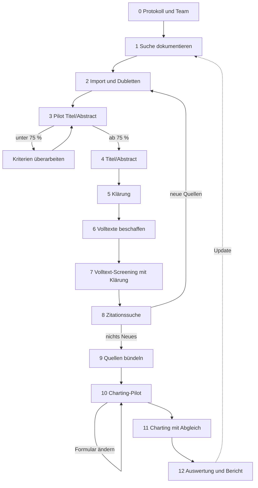

# Review-Workflow: Plan nach JBI und Rayyan

Stand 19.11.2026. Dieser Plan legt den vollständigen Ablauf eines Scoping Reviews im Tool fest, vom Protokoll bis
zum Bericht, und beschreibt, wie andere Review-Typen als Vorlagen darauf aufsetzen. Er ergänzt `anforderungsanalyse.md` um zwei neue Grundlagen:

- **JBI Manual, Kapitel 10 in der überarbeiteten Fassung** (abgerufen am 19.11.2026). Das Kapitel wurde neu
  gegliedert. Die Abschnittsnummern in `anforderungsanalyse.md` (10.2.5 Suche, 10.2.6 Auswahl, 10.2.7 Extraktion)
  stimmen nicht mehr; aktuell gilt die Tabelle unten.
- **Rayyan in der App selbst**, an einem Test-Review mit zwölf erfundenen Einträgen durchgespielt (19.11.2026).
  Die bisherige Analyse beruhte nur auf dem Help Center.

Nicht gelesen: Abschnitt 2.4 des JBI Manuals, auf den 10.2.6 für die Suche verweist. Ob die dreistufige Suche dort
unverändert steht, ist offen. In Rayyan nicht geprüft: alles, was eine zweite Person braucht (Konfliktansicht,
Entblinden mit fremden Stimmen), und die bezahlten Funktionen.

## Was JBI verlangt (Fassung 2026)

| Abschnitt | Vorgabe | Folge für das Tool |
| --- | --- | --- |
| 10.2.2–10.2.5 Protokoll | Fragestellung, Kriterien nach PCC, Quellenarten, Vorgehen bei Suche, Auswahl, Extraktion und Darstellung; wer was macht; wie Uneinigkeit gelöst wird | Protokoll-Station mit Pflichtangaben, bevor die erste Stufe öffnet |
| 10.2.6 Suche | Wie Systematic Reviews (Verweis auf 2.4). Graue Literatur planen. Bei Google vorab festlegen, wie viele Treffer gesichtet werden. Abbruchregel im Protokoll | Suchversion je Quelle, mit Trefferlimit und Abbruchregel als Feldern |
| 10.2.7 Auswahl | Sechs Schritte: Treffer sammeln, Dubletten entfernen und zählen, Titel/Abstract, Volltext, Ausschlussgründe im Volltext als Anhang, Zitationssuche vorwärts und rückwärts bis nichts Neues kommt | Reihenfolge der Stationen; Zitationssuche als Schleife |
| 10.2.7 Auswahl | Ideal zwei Personen unabhängig. Zulässig: eine Person plus Stichprobenkontrolle, eine Person plus Prüfung der Ausschlüsse, oder „accelerated liberal“ (eine Stimme schließt ein, zwei schließen aus). Eine Person allein nur bei Rapid Reviews. Im Zweifel einschließen | Auswahlregel je Stufe wählbar, nicht fest „zwei einstimmig“ |
| 10.2.7.1 Pilot | 25 zufällige Titel/Abstracts, ganzes Team, Abweichungen besprechen, Kriterien und Erläuterungsdokument anpassen, Start erst ab 75 % Übereinstimmung | Pilot-Stufe mit Gate und Rückschleife |
| 10.2.7.1 Uneinigkeit | Diskussion der beiden Personen oder Entscheid durch eine dritte Person, die den Eintrag weder gescreent noch extrahiert hat. Vorgehen im Protokoll und im Bericht nennen | Klärungsregel je Review; bei Dritt-Entscheid prüfen, dass die Person keine eigene Stimme hat |
| 10.2.8 Bewertung | Nicht empfohlen. Falls doch: beschreibend, Instrument in die Extraktionstabelle aufnehmen | Keine eigene Stufe; Bewertung sind Felder im Charting-Formular |
| 10.2.9 Extraktion | Formular mit Anleitung je Feld (Name, Beschreibung, Format, Werte). Geschlossene Antworten bevorzugen. Ideal zwei Personen unabhängig, sonst eine plus Gegenprüfung (als Limitation nennen) | Typisiertes Formular; Modus doppelt oder einfach mit Prüfung |
| 10.2.9.1 Formular | Änderungen auf den Pilot beschränken. Spätere Änderungen sind Abweichungen vom Protokoll und zu berichten | Formularversion nach dem Pilot ändern heißt: Begründung Pflicht, erscheint in der Abweichungsliste |
| 10.2.9.2 Pilot | Je Quellenart mindestens 2–3 Einträge, alle Extrahierenden unabhängig. Fünf Prüffragen, darunter die benötigte Zeit. Danach Gruppendiskussion | Charting-Pilot je Quellenart; Zeit je Eintrag erfassen |
| 10.2.10 Analyse | Je Frage und Feld vorab festlegen: Datenformat, Methode (Häufigkeiten oder einfache Inhaltsanalyse), Darstellung. Keine Meta-Analyse | Analyseplan am Formularfeld; Häufigkeitstabellen als Export |
| 10.2.10.1 Doppelzählung | Begleitpublikationen derselben Stichprobe zu einem Bericht bündeln (n = 1). Bei eingeschlossenen Evidenzsynthesen Überschneidung mit Primärstudien offenlegen | Station „Quellen bündeln“ vor dem Charting |
| 10.3 Bericht | PRISMA-ScR; eine neue Fassung ist für 2026 angekündigt | Berichtsvorlage als austauschbare Version führen |
| 10.4 Update | Suche wiederholen, gleiche Kriterien, Änderungen dokumentieren | Update ist ein neuer Import in dasselbe Review, keine Kopie |

## Was Rayyan tut (Beobachtung in der App)

| Schritt | Verhalten | Bewertung |
| --- | --- | --- |
| Anlegen | Assistent mit drei Schritten: Angaben (Titel, Review-Typ, Fachgebiet), Dateien hochladen (bis zu 10), Mitglieder einladen (Rolle, Nachricht). Danach eine Checkliste mit fünf Punkten bis „Kriterien definieren“ | Übernehmen: geführter Einstieg und sichtbare Checkliste |
| Übersicht | Kacheln für Importe und Dubletten, Mitglieder, eigener Fortschritt mit Zeitaufwand, Team-Fortschritt, offene Konflikte | Übernehmen als Startseite je Review |
| Phasen | Feste Reiter: Review data, Screening, Full text screening, Data extraction, Risk of bias. Kein Pilot, keine Suche, kein Bericht außer PRISMA | Reiter als Leiste übernehmen, aber aus dem Stufenmodell erzeugt |
| Verblindung | Ein Schalter für das ganze Review und alle Phasen, mit Rückfrage | Anders: je Stufe, wie schon umgesetzt |
| Kriterien | Zwei Listen mit Kürzeln (I1, E1), dienen als Text und für die KI. Nicht mit den Ausschlussgründen verbunden | Anders: Ausschlussgründe sind die Kriterien-Kürzel |
| Dubletten | Start von Hand. Ein exakt doppelter Testeintrag (gleicher Titel, Autor, Jahr, DOI) wurde nicht gefunden; Ursache nicht geprüft | Eigene Regeln mit Protokoll bleiben nötig |
| Screening | Drei Spalten: Liste mit Entscheidungs-Chips, Eintrag mit markierten Begriffen, Filter. Autoren und Zeitschrift sind standardmäßig ausgeblendet. Nach der Entscheidung springt die Ansicht weiter | Übernehmen, auch das Ausblenden von Autoren und Zeitschrift |
| Gründe | Vorgegebene Liste (wrong population, wrong outcome, …) plus eigene, Mehrfachauswahl, Tastenkürzel je Grund. Ausschluss ohne Grund ist auch im Volltext möglich | Kürzel je Grund übernehmen; im Volltext genau ein Hauptgrund Pflicht |
| Filter | Entscheidung (alle, offen, ein, aus, vielleicht, Konflikt), Zahl der Stimmen (keine, mindestens, höchstens), Person, Schlagwörter mit Trefferzahl, Labels. Konflikt und Person sind verblindet gesperrt | Übernehmen; Sperre folgt aus `blind_active` |
| Stichproben | Quelle (alle oder gefiltert), Methode, Name, Anteil oder Anzahl, mehrere Stichproben bis zusammen 100 % | Seed fehlt; bei uns vorhanden |
| Übergang in den Volltext | Von Hand: „Add articles“ aus der Quelle Screening, wahlweise Eingeschlossene, „Maybe“ oder Einträge mit Label. Stimmen beginnen neu | Anders: Folgestufe mit fester Eingangsmenge aus `final_decisions` (vorhanden als `from_stage`) |
| Volltext | Tabelle mit Spalte „Full text“ (None), DOI öffnen, PDF anhängen, automatische Beschaffung, Filter nach PDF | Beschaffungsstatus je Eintrag übernehmen |
| Extraktion | Tabelle: Zeilen sind Einträge, Spalten sind Fragen. Frage mit Spaltentitel, Fragetext, Pflicht, Antworttyp (Freitext, Zahl, Auswahl), Gruppe. Status: nicht begonnen, unvollständig, fertig | Übernehmen als Charting-Ansicht |
| PRISMA | Eigene Seite. Im Test: 12 „gescreent“ bei 8 Entscheidungen; Gründe aus Titel/Abstract erscheinen bei den ausgeschlossenen Volltexten; „nicht beschafft“ ergibt sich aus fehlenden PDFs | Zahlen je Stufe getrennt aus dem Log rechnen |

## Der Ablauf im Tool

Jede Station hat eine Eingangsmenge, eine Regel für den Abschluss und ein Ergebnis, das die nächste Station
freischaltet. Die Leitung kann eine Abschlussregel mit Begründung übersteuern; das steht dann im Log.

| Nr. | Station | Eingang | Abschluss (Gate) | Ereignisse | Stand |
| --- | --- | --- | --- | --- | --- |
| 0 | Protokoll und Team | – | Kriterien veröffentlicht, Auswahl- und Klärungsregel gewählt, mindestens zwei Personen mit Schreibrecht | `ReviewCreated`, `MemberRoleSet`, `CriteriaVersionPublished`, neu `WorkflowVersionPublished`, `ProtocolRegistered` | Review, Rollen, Kriterien als Text vorhanden; Regeln und Registrierung neu |
| 1 | Suche | Protokoll | Je Quelle eine Suchversion mit Datum | neu `SearchVersionPublished` | neu |
| 2 | Import und Dubletten | Suchversionen | Keine ungeklärten Dublettenpaare | `RecordsImported`, neu `DuplicatesResolved` | Import und exakter Abgleich vorhanden; Bezug zur Suchversion, unscharfer Abgleich und Prüfansicht neu |
| 3 | Pilot Titel/Abstract | Zufallsstichprobe, 25, mit Seed | Übereinstimmung ≥ 75 %; sonst Kriterien überarbeiten und neue Runde | `StageInstanceOpened` (Runde), neu `GateEvaluated`, `GateOverridden` | Stufe, Stichprobe, Kennzahlen vorhanden; Gate und Runden neu |
| 4 | Titel/Abstract | Alle Einträge ohne Dubletten | Jeder Eintrag hat die nötige Zahl Stimmen | `VoteCast`, `VoteRevised`, `RecordFlaggedUndecidable` | vorhanden; Auswahlregeln außer „einstimmig“ neu |
| 5 | Klärung | Abweichungen und Markierte | Keine offenen Konflikte | `StageUnblinded`, `ConsensusRecorded`, `StageInstanceClosed`, `SnapshotTaken` | vorhanden; Prüfung „dritte Person ohne eigene Stimme“ neu |
| 6 | Volltexte beschaffen | Eingeschlossene aus 5 | Jeder Eintrag ist „beschafft“ oder „nicht beschaffbar“ mit Grund | neu `FullTextStatusSet` | neu |
| 7 | Volltext-Screening | Beschaffte Volltexte | Wie 4 und 5; Ausschluss nur mit genau einem Hauptgrund | wie 4 und 5 | Folgestufe vorhanden; Pflichtgrund neu |
| 8 | Zitationssuche | Eingeschlossene aus 7 | Durchlauf ohne neue Einschlüsse oder dokumentierte Grenze | `RecordsImported` mit Herkunft „Zitationssuche“ | neu |
| 9 | Quellen bündeln | Eingeschlossene aus 7 | Von der Leitung bestätigt | neu `RecordsLinkedToStudy` | neu |
| 10 | Charting-Pilot | 2–3 Quellen je Quellenart | Gruppe bestätigt das Formular | neu `ChartingFormVersionPublished`, `ChartingValueRecorded` | neu |
| 11 | Charting | Gebündelte Quellen | Alle Pflichtfelder gefüllt, keine offenen Abweichungen | `ChartingValueRecorded`, neu `ChartingConsensusRecorded` | neu |
| 12 | Auswertung und Bericht | Alles | – | – (Projektionen und Exporte) | CSV je Stufe vorhanden; Rest neu |

**Auswahlregeln (Station 4 und 7).** Die Regel steht in `StageInstanceOpened` und gilt wie `maybe_as` ab dem ersten
Öffnen der Stufe.

| Regel | Entscheidung | JBI |
| --- | --- | --- |
| `unanimous` (Standard) | Alle Stimmen gleich, mindestens `min_reviewers`; sonst Klärung | Ideal |
| `liberal` | Eine Einschluss-Stimme genügt; Ausschluss braucht zwei | „accelerated liberal“ |
| `single_verified` | Eine Stimme entscheidet; eine zweite Person prüft alle Ausschlüsse oder eine Stichprobe mit Seed | zulässige Alternative, als Limitation zu berichten |

**Rückschleifen.** Eine wiederholte Station ist eine neue Stufeninstanz mit Rundennummer und der dann gültigen
Kriterienversion. Runden bleiben nebeneinander sichtbar, etwa Übereinstimmung Pilot 1 gegen Pilot 2.

**Verblindung beim Charting.** Unabhängig extrahierte Werte müssen wie Stimmen in der Stufenkette liegen, damit
Pakete sie weglassen können. `ChartingValueRecorded` gehört deshalb in `event::is_blindable`.

## Review-Typen als Vorlagen

Der Ablauf oben ist die Vorlage „JBI Scoping Review“. Andere Review-Typen nutzen denselben Kern (Import, Dubletten,
Pilot, verblindetes Screening, Klärung, Volltext mit Gründen, Snapshots, Übereinstimmung). Sie unterscheiden sich in
den Voreinstellungen und in den Stationen nach dem Screening. Der Review-Typ wählt beim Anlegen eine Vorlage; sie
legt Kriterienschema, Stationsliste, Auswahlregel, Mindeststimmen, Klärungsregel, Gate-Schwellen, Pflichtfelder,
Begriffe und Berichtscheckliste fest und steht als `WorkflowVersionPublished` im Log.

Belegt sind die Scoping-Vorlage (JBI Kapitel 10), der Rapid Review (Garritty et al. 2024) und der
State-of-the-Art-Review (Barry et al. 2022); die beiden letzten sind gebaut. Die übrigen Zeilen stammen aus der bestehenden Analyse (MECIR)
und aus Vorwissen, nicht aus einer neuen Recherche. Vor dem Bau einer Vorlage ist ihre Leitlinie zu lesen.

| Vorlage | Abweichung von der Scoping-Vorlage | Neue Bausteine |
| --- | --- | --- |
| Rapid Review | Doppelte Bewertung einer Stichprobe, danach `single_verified` statt `unanimous`; Extraktion durch eine Person mit Prüfung. Jede Abkürzung erscheint als Limitation im Methodentext | keine |
| State of the Art, Literature Review | Kein verbindlicher Standard; sechs Schritte nach Barry et al. 2022. Eine Stimme je Eintrag, Gates abgeschaltet, der Zeitraum als Kriterium | keine |
| Systematic Review | Kriterien nach PICO. Zwei unabhängige Personen Pflicht (`unanimous`, nicht abwählbar). Bias-Bewertung Pflicht und doppelt. Extraktion mit Zahlenwerten je Studienarm und Zeitpunkt. Bericht nach PRISMA 2020, Begriff „Studien“ statt „Quellen“ | Bewertungsstufe, numerische Extraktion mit wiederholbaren Gruppen, Export für R oder RevMan |
| Umbrella Review | Einheit sind Reviews statt Primärstudien. Bewertung der Reviews. Übersicht, welche Primärstudien sich überschneiden | Bewertungsstufe, Überschneidungsmatrix |
| Qualitativ, Mixed Methods | Anderes Kriterienschema. Bewertung mit passenden Checklisten. Extraktion von Befunden mit Belegzitaten | Bewertungsstufe, Feldtyp „Befund mit Zitat“ |

**Was dafür nicht fest verdrahtet sein darf:**

- **Kriterienschema.** PCC ist eine von mehreren Vorlagen für die Elemente (PCC, PICO, frei). Kriterien verweisen
  auf ein Element des gewählten Schemas, nicht auf feste Spalten.
- **Stationsarten.** Die Bewertung ist eine normale Stufe mit Formular und nutzt Formularversionen, Verblindung,
  Abweichungen und Abgleich des Chartings. In der Scoping-Vorlage ist sie abgeschaltet; wer dort doch bewertet,
  nimmt die Felder ins Charting-Formular auf, wie JBI 10.2.8 es vorsieht.
- **Einheit über den Einträgen.** `RecordsLinkedToStudy` bündelt Begleitpublikationen (Scoping) und ordnet Berichte
  Studien zu (Systematic Review). Charting und Bewertung hängen an dieser Einheit, nicht am einzelnen Eintrag.
- **Begriffe und Checkliste im Bericht.** „Quellen“ oder „Studien“, PRISMA-ScR oder PRISMA 2020 kommen aus der
  Vorlage.
- **Zahlen in Payloads.** Gleitkommazahlen sind verboten. Dezimalwerte der numerischen Extraktion werden als Text
  gespeichert, so wie sie in der Quelle stehen, damit nichts gerundet wird.

Meta-Analyse und GRADE kommen nicht ins Tool. Dafür gibt es einen Export.

In Rayyan ist der Review-Typ eine Auswahl beim Anlegen (Systematic, Literature, Umbrella, Scoping, Rapid,
Qualitative, State of the art und weitere). Ob er dort den Ablauf ändert, ist nicht geprüft; angelegt wurde nur ein
Scoping Review.

## Arbeitspakete

Wie die Pakete gebaut werden, mit Grundsatzentscheidungen, Ereignissen und Meilensteinen, steht in
`umsetzungsplan.md`.

Die Reihenfolge folgt dem Ablauf. Jedes Paket endet mit einem Test in `flow.rs`, der die Station nur über Pakete
und Rückmeldungen durchspielt.

| Paket | Inhalt | Prüfung |
| --- | --- | --- |
| 1 Ablauf-Rückgrat | Vorlagenformat mit Kriterienschema, Stationsliste, Regeln, Schwellen und Begriffen; „JBI Scoping Review“ als erste Vorlage, veröffentlicht als `WorkflowVersionPublished`. Die Oberfläche liest Stationen und Begriffe aus der Vorlage. Stationsleiste und Checkliste in der Oberfläche. Gates beim Abschluss (`GateEvaluated`, `GateOverridden`). Rundennummer. Auswahlregeln `liberal` und `single_verified` in `projection.rs` | Pilot unter 75 % sperrt Station 4; Übersteuern mit Begründung öffnet sie; `liberal` gegen Handrechnung |
| 2 Kriterien | Kriterien als Liste mit Kürzel, Element des Schemas (PCC aus der Vorlage), Text, Erläuterung statt Freitext. Ausschlussgründe verweisen auf Kürzel. Hauptgrund im Volltext Pflicht. Erläuterung in der Screening-Ansicht. Autoren und Zeitschrift ausblendbar, Tastenkürzel je Grund | Volltext-Ausschluss ohne Grund wird abgewiesen, auch beim Einlesen einer Rückmeldung |
| 3 Suche und Import | `SearchVersionPublished` (Quelle, Plattform, Suchstring, Datum, Limits, Trefferlimit). Import verweist auf eine Suchversion. Quellenart je Eintrag. PubMed-Format. Unscharfe Dubletten mit Prüfansicht und `DuplicatesResolved` | Treffer je Quelle und Dublettenzahl stimmen mit dem Import überein |
| 4 Volltext | `FullTextStatusSet` (beschafft, nicht beschaffbar mit Grund). PDF lokal zuordnen und anzeigen; im Log nur die Prüfsumme. DOI öffnen | Station 7 enthält nur beschaffte Einträge; „nicht beschafft“ erscheint in den Zahlen |
| 5 Bericht, Teil 1 | Projektion `prisma_counts` mit Gründen je Stufe. Flussdiagramm nach PRISMA-ScR, Begriffe aus der Vorlage. Liste der ausgeschlossenen Volltexte mit Grund. Methodentext zur Auswahl. Suchanhang | Zahlen des Diagramms gegen den Ablauftest; Summe je Ebene geht auf |
| 6 Zitationssuche und Bündeln | Import mit Herkunft „Zitationssuche“, Zweig „andere Quellen“ im Diagramm. Nur neue Einträge durchlaufen 2–7. `RecordsLinkedToStudy` | Zweiter Durchlauf legt nur neue Einträge vor; gebündelte Quellen zählen als eine |
| 7 Charting | Formularversionen mit typisierten Feldern (Freitext, Zahl, Auswahl, Mehrfachauswahl) und Analyseplan. Pilot je Quellenart mit Zeiterfassung. Tabellenansicht mit Status. Doppelt oder einfach mit Prüfung, Abweichungen und Abgleich. Export und Häufigkeitstabellen | Feld nach dem Pilot ergänzt: bearbeitete Quellen erscheinen als „nachzutragen“, die Änderung in der Abweichungsliste |
| 8 Bericht, Teil 2 und Update | `ProtocolRegistered` und Abweichungsliste. Methodentext zum Charting. Update als neuer Import mit eigener Suchversion. Zotero | Alles nach der Registrierung Versionierte steht in der Liste |
| 9 Weitere Vorlagen ohne neue Bausteine | Rapid Review und State of the Art als Vorlagen. Limitation im Methodentext bei abgekürzter Auswahl | Ein Review je Vorlage läuft im Ablauftest ohne Änderung am Kern durch |
| 10 Systematic Review | PICO-Schema, Bewertungsstufe mit Urteilen je Domäne, numerische Extraktion mit wiederholbaren Gruppen, PRISMA 2020, Export für R oder RevMan. Umbrella und qualitative Reviews bauen auf der Bewertungsstufe auf | Dezimalwerte überstehen Export und Einlesen unverändert; Bewertung doppelt mit Abgleich |

## Offene Entscheidungen

- **Volltexte:** entschieden am 19.11.2026. Sie kommen aus einem verknüpften Ordner oder aus Zotero und liegen
  nicht im Paket; im Log steht die Prüfsumme. Einzelheiten in `umsetzungsplan.md`, Meilenstein 4.
- **Gate-Kennzahl im Pilot:** Vorschlag: Prozent-Übereinstimmung mit der Maybe-Regel der Stufe, wie JBI es
  formuliert. Kappa und Alpha werden daneben angezeigt, sperren aber nicht.
- **Dritt-Entscheid:** JBI verlangt eine Person ohne eigene Stimme zu dem Eintrag. Vorschlag: bei der Regel
  „Dritt-Entscheid“ erzwingen, bei „Diskussion“ nicht.
- **Leitlinien der weiteren Vorlagen:** Für Paket 9 sind die Empfehlungen der Cochrane Rapid Reviews Methods Group
  und der Ansatz von Barry et al. ausgewertet (siehe Quellen). Vor Paket 10 stehen noch aus: Cochrane Handbook und
  MECIR, JBI Kapitel zu Umbrella und qualitativen Reviews.
- **Abschnitt 2.4 des JBI Manuals** vor Paket 3 lesen, ebenso die neue PRISMA-ScR, sobald sie erschienen ist.

## Quellen

Rapid Review und State of the Art (abgerufen am 19.11.2026):
Garritty C et al. [Updated recommendations for the Cochrane rapid review methods guidance for rapid reviews of
effectiveness](https://doi.org/10.1136/bmj-2023-076335). BMJ 2024;384:e076335.
Barry ES, Merkebu J, Varpio L. [State-of-the-art literature review methodology: A six-step approach for knowledge
synthesis](https://pmc.ncbi.nlm.nih.gov/articles/PMC9582072/). Perspect Med Educ 2022;11:281–288.

JBI Manual for Evidence Synthesis, Kapitel 10 (abgerufen am 19.11.2026):
[10.2.5 Planned approach](https://jbi-global.atlassian.net/wiki/spaces/MANUAL/pages/355862729),
[10.2.6 Searching](https://jbi-global.atlassian.net/wiki/spaces/MANUAL/pages/355862749),
[10.2.7 Selecting](https://jbi-global.atlassian.net/wiki/spaces/MANUAL/pages/355862769),
[10.2.7.1 Piloting the selection](https://jbi-global.atlassian.net/wiki/spaces/MANUAL/pages/2049540102),
[10.2.8 Critical appraisal](https://jbi-global.atlassian.net/wiki/spaces/MANUAL/pages/355862791),
[10.2.9 Extracting](https://jbi-global.atlassian.net/wiki/spaces/MANUAL/pages/355862811),
[10.2.9.1 Extraction form](https://jbi-global.atlassian.net/wiki/spaces/MANUAL/pages/2051637250),
[10.2.9.2 Piloting the extraction](https://jbi-global.atlassian.net/wiki/spaces/MANUAL/pages/2051473426),
[10.2.10 Analysing](https://jbi-global.atlassian.net/wiki/spaces/MANUAL/pages/2050523146),
[10.2.10.1 Double-counting](https://jbi-global.atlassian.net/wiki/spaces/MANUAL/pages/2050392084),
[10.2.11 Presentation](https://jbi-global.atlassian.net/wiki/spaces/MANUAL/pages/2052063236),
[10.3 Reporting](https://jbi-global.atlassian.net/wiki/spaces/MANUAL/pages/355862853),
[10.4 Updating](https://jbi-global.atlassian.net/wiki/spaces/MANUAL/pages/355863308).

Rayyan: eigene Beobachtung in der Web-App an einem Test-Review, 19.11.2026.
