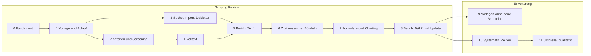

# Umsetzungsplan: vollständiger Workflow mit Vorlagen je Review-Typ

Stand 19.11.2026. Dieser Plan beschreibt, wie der Ablauf aus `review-workflow.md` gebaut wird, einschließlich der
Erweiterung um andere Review-Typen. Er verfeinert die Tabelle „Arbeitspakete“ dort und ersetzt den älteren
Phasenplan in `anforderungsanalyse.md`.

Grundlage ist der Code auf dem Zweig `native-app` (Kern rund 3.400 Zeilen, Oberfläche rund 1.700). Die Größen
unten (S, M, L) sind Schätzungen im Verhältnis zueinander, keine Termine.

## Ausgangslage im Code

| Bereich | Heute | Folge für den Plan |
| --- | --- | --- |
| Ereignistypen | 12 Typen als Zeichenketten. Wer was schreiben darf, steht in drei getrennten Listen (`event::is_blindable`, `MANAGEMENT_EVENTS` und `STAGE_WRITE_EVENTS` in `exchange.rs`). Payloads werden nicht geprüft | Rund 20 neue Typen kommen dazu. Vorher braucht es ein Register an einer Stelle |
| Einlesen | `exchange::authorize` kennt nur zwei Klassen: Verwaltung (Owner, Admin) und Stufen-Ereignisse. Unbekannte Typen werden abgewiesen | Eine ältere App weist Dateien einer neueren ab. Das Dateiformat braucht eine Versionsprüfung mit klarer Meldung |
| Stufen | `StageInstanceOpened` mit `kind`, `blind`, `min_reviewers`, `maybe_as`, Umfang (`all`, `sample`, `from_stage`). Die Oberfläche leitet `kind` aus dem Umfang ab | Stufen brauchen Station, Runde, Auswahlregel und Formular |
| Entscheidung | `StageState::final_decisions` kennt nur „einstimmig ab `min_reviewers`“ | Auswahlregeln als Erweiterung an genau dieser Stelle |
| Kriterien | Freitext, zwei Schlagwortlisten, Liste von Gründen als Text | Strukturierte Kriterien mit Kürzeln; alte Versionen müssen lesbar bleiben |
| Tabellen | `CREATE TABLE IF NOT EXISTS`, keine Migrationen. Records sind über `records_sha256` festgeschrieben | Neue Angaben zu einem Eintrag (Dublette, Volltext, Quellenart, Studie) werden Ereignisse, keine Spalten |
| Oberfläche | Eine Review-Seite mit sechs Reitern, Stufenseite, Screening-Seite | Umbau auf Stationen aus der Vorlage |

## Grundsatzentscheidungen

**1. Die Vorlage steht im Log.** Mitgelieferte Vorlagen liegen als JSON in `crates/ort-core/templates/` und werden
eingebettet. Beim Anlegen wird die gewählte Vorlage vollständig in `WorkflowVersionPublished` kopiert. Ein Review
hängt damit nie von der App-Version ab, und eine geänderte Vorlage ist eine neue Version mit Begründung. Reviews
ohne dieses Ereignis laufen als „freier Ablauf“ ohne Gates weiter wie bisher.

Eine Vorlage enthält:

| Teil | Inhalt | Beispiel JBI Scoping |
| --- | --- | --- |
| `review_type`, `terms` | Typ und Begriffe der Oberfläche und des Berichts | „Quellen“, „Charting“ |
| `criteria_schema` | Elemente, denen Kriterien zugeordnet werden | Population, Concept, Context, Quellenart |
| `stations` | Geordnete Liste mit Schlüssel, Art, Voreinstellungen und Gate | siehe `review-workflow.md` |
| `rules` | Auswahlregel, Mindeststimmen, Maybe-Regel, Klärungsregel; je Regel, ob sie änderbar ist | `unanimous`, 2, änderbar |
| `forms` | Startformulare | Charting-Grundfelder |
| `report` | Checkliste, Diagrammvariante, Textbausteine | PRISMA-ScR |

**2. Ein Register für Ereignistypen** (`catalog.rs`). Je Typ: Kette (`main` oder Stufe), verblindbar ja oder nein,
nötige Rolle, Prüffunktion für den Payload mit Zugriff auf Stufe und Kriterienversion. `Store::append`,
`exchange::authorize` und der Paketfilter lesen nur noch dieses Register. Neu ist eine dritte Klasse neben
Verwaltung und Stufen-Ereignissen: Ereignisse in `main`, die auch Reviewer schreiben dürfen (Volltextstatus).

**3. Stationsarten statt fester Phasen.** Es gibt vier Arten; jede Vorlage setzt ihren Ablauf daraus zusammen.

| Art | Arbeitet auf | Stufeninstanz | Stationen |
| --- | --- | --- | --- |
| `setup` | Review | nein | Protokoll, Suche, Import und Dubletten, Volltexte beschaffen, Quellen bündeln |
| `screening` | Einträge, Stimmen ein/aus/vielleicht | ja | Pilot, Titel/Abstract, Volltext, Prüfung der Ausschlüsse |
| `form` | Quellen oder Studien, Formular mit Feldern | ja | Charting-Pilot, Charting, Bewertung |
| `report` | Projektionen | nein | Auswertung und Bericht |

Bewertung und Charting sind dieselbe Art mit verschiedenen Formularen. Damit braucht der Systematic Review kein
eigenes Bewertungsmodul.

**4. Einheit über den Einträgen ohne neue Zuweisungstabelle.** `RecordsLinkedToStudy` nennt eine Studie, ihre
Einträge und einen Haupteintrag. Formular-Stufen weisen den Haupteintrag zu; die übrigen Einträge der Studie werden
daneben angezeigt. `stage_assignment` und ihre Prüfsumme bleiben unverändert.

**5. Zahlen.** Gleitkommazahlen bleiben in Payloads verboten. Gate-Werte stehen als Zähler und Nenner, Anteile
zusätzlich in Hundertstel Prozent. Dezimalwerte aus Quellen stehen als Text, geprüft gegen ein Muster.

**6. Formularwerte bleiben einzelne Ereignisse** (entschieden am 19.11.2026). Jeder Wert ist ein
`FormValueRecorded` mit Quelle, Feld, Gruppenindex, Wert und Formularversion, in der Kette der Stufe und damit
verblindbar. Es gilt der neueste Wert je Person, Quelle und Feld. `FormEntryCompleted` meldet einen Eintrag als
fertig; erst fertige Einträge gehen in den Abgleich. Es gibt keine Entwürfe außerhalb des Logs: geschrieben wird
beim Verlassen eines Feldes, nicht bei jedem Tastendruck. Die Typen heißen `Form…` statt `Charting…` wie im
Ereigniskatalog, weil die Bewertung sie später mitnutzt.

**7. Volltexte liegen außerhalb der App** (entschieden am 19.11.2026). Quelle ist ein verknüpfter Ordner oder
Zotero. Im Log stehen nur Prüfsumme, Herkunft und relativer Pfad oder Zotero-Schlüssel. Wo der Ordner auf dem
jeweiligen Rechner liegt, ist eine lokale Einstellung und steht nicht im Log; ein geteilter Cloud-Ordner
funktioniert damit für das ganze Team. Die App zeigt Volltexte an, verändert die Dateien aber nie.

## Neue Ereignisse

| Ereignis | Kette | Schreibt | Meilenstein |
| --- | --- | --- | --- |
| `WorkflowVersionPublished` | main | Leitung | 1 |
| `GateEvaluated`, `GateOverridden` | main | Leitung | 1 |
| `CriteriaVersionPublished` (Schema 2) | main | Leitung | 2 |
| `SearchVersionPublished`, `SearchPeerReviewed` | main | Leitung | 3 |
| `DuplicatesResolved` | main | Leitung | 3 |
| `FullTextStatusSet` | main | alle mit Schreibrecht | 4 |
| `ZoteroLibraryLinked`, `ZoteroItemMapped` | main | Leitung | 4 |
| `FullTextHighlightAdded`, `FullTextHighlightRemoved` | Stufe, verblindbar | alle mit Schreibrecht | 4 (zweiter Schritt) |
| `RecordsLinkedToStudy`, `SourceTypeSet` | main | Leitung | 6 |
| `FormVersionPublished` | main | Leitung | 7 |
| `FormValueRecorded`, `FormEntryCompleted` | Stufe, verblindbar | alle mit Schreibrecht | 7 |
| `FormConsensusRecorded` | main | alle mit Schreibrecht, erst nach dem Entblinden | 7 |
| `ProtocolRegistered` | main | Leitung | 8 |

Geänderte Payloads: `ReviewCreated` bekommt `review_type`. `StageInstanceOpened` bekommt `station`, `round`,
`decision_rule`, `verify`, `reason_required`, `form_id` und `form_version`. `VoteCast` und `ConsensusRecorded`
bekommen `primary_reason`. `RecordsImported` bekommt `search_version` und `origin`.

## Meilensteine

Jeder Meilenstein endet mit grünen Kerntests, einem erweiterten Ablauftest in `flow.rs` (nur über Pakete und
Rückmeldungen) und einem Durchlauf von Hand in der App.

Zuerst wird der Scoping Review vollständig gebaut (Meilensteine 0 bis 8, entschieden am 19.11.2026). Weitere
Review-Typen folgen danach als Erweiterung (9 bis 11). Damit die Erweiterung später keinen Umbau verlangt, bleiben
Vorlagenformat, Stationsarten und Begriffe von Anfang an unverdrahtet; mehr wird für andere Typen vorher nicht
gebaut.

### 0 Fundament (M)

Keine sichtbare Änderung; schafft die Voraussetzungen.

- `catalog.rs` mit den zwölf bestehenden Typen; die drei Listen entfallen. Payload-Prüfung beim Anhängen und beim
  Einlesen.
- Migrationen in `store.rs` über `PRAGMA user_version`.
- Dateiformat Version 2. `Bundle::from_json` meldet bei höherer Version: „Diese Datei stammt aus einer neueren
  Version der App.“
- Umwandlung alter Payloads beim Lesen (`schema_version`), zuerst für die Kriterien.
- Messung: Projektionen mit 20.000 Einträgen, zwei Stimmen je Eintrag. Alles wird bei jedem Aufruf neu berechnet;
  wenn das zu langsam ist, kommt ein Zwischenspeicher je Stufe, der an den Köpfen der Ketten hängt.

Prüfung: alle 47 Tests unverändert grün; ein Ereignis mit ungültigem Payload wird beim Einlesen einzeln abgewiesen.

### 1 Vorlage und Ablauf (L)

Stand 19.11.2026: umgesetzt. Festlegungen beim Bau:

- Die Klärungsregel steht wie die Auswahlregel in `StageInstanceOpened` (`conflict_rule`), damit jede Stufe für
  sich prüfbar bleibt. Die Vorlage liefert die Vorgabe und legt fest, ob sie änderbar ist.
- Eine Station mit Gate sperrt alle späteren Stationen. Schließen einer Stufe ist auch mit nicht erfülltem Gate
  möglich; das Ergebnis steht als `GateEvaluated` im Log. Übersteuern ist ein eigener Schritt (`GateOverridden`)
  und gilt für die Runde, in der es geschrieben wurde.
- Gates von `setup`-Stationen (`criteria_published`, `min_writers`, `records_imported`) werden laufend aus dem
  Stand berechnet und nicht als Ereignis festgehalten.
- `single_verified` schließt Verblindung aus. Die Prüfmenge ergibt sich aus SHA-256 über „Seed:Eintrags-ID“.
- Stationen, die erst spätere Meilensteine bringen, stehen schon in der Vorlage, haben aber noch kein Gate. Wenn
  sie eines bekommen, ist das für bestehende Reviews eine neue Vorlagenversion.
- `StageInstanceOpened` hat Schema-Version 2; eine App vom Stand Meilenstein 0 weist solche Stufen ab.

- Vorlagenformat, Vorlage „JBI Scoping Review“ und eine zweite, minimale Vorlage „Freier Ablauf“ (eine Stimme,
  keine Gates). Die zweite Vorlage beweist, dass nichts fest verdrahtet ist, und dient bestehenden Reviews.
- `workflow.rs`: Projektion der Stationen mit Zustand (gesperrt, offen, läuft, abgeschlossen), Runden und Gates.
- Gates beim Abschluss einer Stufe: `agreement_min` (Pilot, Prozent mit der Maybe-Regel der Stufe),
  `all_decided`, `no_open_conflicts`. `open_stage` prüft das Gate der Vorstation; Übersteuern braucht einen Text.
- Auswahlregeln in `final_decisions`: `unanimous`, `liberal`, `single_verified`. Bei `single_verified` verlangt
  die Stufe eine zweite Stimme für ausgeschlossene Einträge, für alle oder für eine Stichprobe. Ob ein Eintrag in
  die Stichprobe fällt, ergibt sich aus Seed und Eintrags-ID und ist damit nachrechenbar.
- Klärungsregel „Dritt-Entscheid“: `record_consensus` und das Einlesen weisen einen Konsens von Personen mit
  eigener Stimme zu diesem Eintrag ab.
- Oberfläche: Anlegen in drei Schritten mit Review-Typ, Übersichtsseite mit Checkliste und Kennzahlen,
  Stationsleiste aus der Vorlage. Begriffe kommen aus `terms`.

Prüfung: Pilot unter 75 % sperrt Titel/Abstract; Übersteuern öffnet. `liberal` und `single_verified` gegen
Handrechnung. Derselbe Ablauftest läuft mit beiden Vorlagen.

### 2 Kriterien und Screening-Ansicht (M)

Stand 19.11.2026: umgesetzt. Festlegungen beim Bau:

- Eine Stufe zeigt und prüft die Kriterienversion, mit der sie geöffnet wurde. Eine neue Version gilt ab der
  nächsten Stufe oder Runde.
- Der Pflichtgrund gilt für `exclude`. „Maybe“ braucht keinen Grund, auch wenn die Stufe es als Ausschluss wertet.
  Neben dem Hauptgrund (`primary_reason`) bleiben weitere Gründe (`reasons`) möglich.
- Nennen zwei Personen verschiedene Hauptgründe für denselben Ausschluss, bleibt die Entscheidung „ausgeschlossen“.
  Welcher Grund im Bericht zählt, entscheidet Meilenstein 5.
- Alte Kriterienversionen: Der Freitext wird ein Kriterium ohne Kürzel; jeder alte freie Ausschlussgrund wird ein
  Ausschlusskriterium, dessen Kürzel der alte Wortlaut ist. So passen die Gründe in Stimmen alter Stufen weiter.
- Gründe werden lokal immer gegen die Kürzel geprüft, beim Einlesen nur in Stufen mit Pflichtgrund. Alte Logs mit
  frei getippten Gründen bleiben damit einlesbar.
- `reason_required` ist ein Feld von `StageInstanceOpened` (weiter Schema-Version 2) und kommt aus der Station der
  Vorlage (`fulltext`). Im freien Ablauf lässt es sich je Stufe einschalten. Ohne Ausschlusskriterium mit Kürzel
  öffnet eine solche Stufe nicht.
- Der Schlagwort-Filter meint die Schlagwörter der Kriterien, gesucht in Titel und Abstract. Gesperrt sind
  verblindet die Filter nach Konflikt, nach einer anderen Person und nach der Zahl der Stimmen.
- Eine neue Kriterienversion braucht ab der zweiten eine Änderungsnotiz.

- Kriterien Schema 2: Liste aus Kürzel, Element, Art (ein/aus), Text, Erläuterung; dazu Erläuterungsdokument und
  Schlagwörter. Alte Versionen erscheinen als ein Kriterium ohne Kürzel.
- Gründe sind Kürzel. Bei `reason_required` (Volltext) verlangen `cast_vote`, `record_consensus` und das Einlesen
  genau einen Hauptgrund aus der Kriterienversion der Stufe.
- Screening-Seite in drei Spalten: Liste mit Filtern (Entscheidung, Zahl der Stimmen, Person, Schlagwort),
  Eintrag, Kriterien mit Erläuterung. Autoren und Zeitschrift standardmäßig ausgeblendet. Tastenkürzel je Grund.
  Filter nach Person und Konflikt sind gesperrt, solange `blind_active` gilt; die Sperre sitzt im Kern.

Prüfung: Volltext-Ausschluss ohne Hauptgrund wird lokal und beim Einlesen abgewiesen.

### 3 Suche, Import, Dubletten (M)

- `SearchVersionPublished` mit Quelle, Plattform, Suchstring, Datum, Limits, Trefferlimit, Vorgänger. Der Import
  wählt eine Suchversion und eine Herkunft (Datenbank, Register, Zitationssuche, andere).
- PubMed-Format (nbib) in `import.rs`.
- Unscharfe Dubletten: Kandidaten aus normalisiertem Titel, Jahr und erstem Autor, als Projektion. Entscheidung je
  Paar als `DuplicatesResolved` (Dublette oder keine). Der exakte Abgleich beim Import bleibt. Offene Stufen
  ändern sich nicht; neue Stufen lassen beide Arten von Dubletten weg.
- Gate `no_unresolved_duplicates` vor dem Pilot.

Prüfung: Treffer je Quelle und Dublettenzahl aus dem Log stimmen mit den Importen überein.

### 4 Volltext (L)

- **Ordner:** Die Leitung verknüpft einen Ordner. Die App schlägt Zuordnungen vor (DOI im Dateinamen oder in den
  PDF-Metadaten, sonst Titelähnlichkeit); jede Zuordnung wird bestätigt. Auch einzelne Dateien lassen sich
  zuordnen.
- **Zotero:** `ZoteroLibraryLinked` verknüpft eine Bibliothek oder Collection über die lokale Schnittstelle von
  Zotero. `ZoteroItemMapped` ordnet Einträge über DOI oder Titel einem Zotero-Eintrag zu; dessen PDF-Anhang ist
  der Volltext. Nur lesend. Welche Zotero-Version die lokale Schnittstelle in welchem Umfang bietet, ist vor dem
  Bau zu prüfen.
- `FullTextStatusSet`: beschafft (Herkunft Ordner oder Zotero, Prüfsumme, relativer Pfad oder Zotero-Schlüssel)
  oder nicht beschaffbar (mit Grund). Weicht die Datei später von der Prüfsumme ab, meldet die App das.
- **Vorschau in der App:** Lesen mit Blättern, Zoom und Suche, neben den Entscheidungsknöpfen. Kein Bearbeiten,
  keine Formulare, kein Speichern in die Datei. Die Bytes liefert ein Rust-Befehl nach Prüfung von Pfad und
  Prüfsumme; die WebView greift nicht selbst auf Dateien zu.
- **Markieren, zweiter Schritt:** Markierungen als Ereignisse (`FullTextHighlightAdded` mit Seite, Position, Text
  und Farbe), in der Kette der Stufe und damit verblindbar. Die PDF-Datei bleibt unverändert. Dieser Schritt
  kommt erst, wenn Lesen stabil läuft, und kann hinter Meilenstein 5 rücken.
- Volltext-Stufe: Umfang `from_stage`, eingeschränkt auf beschaffte Einträge. Gate `all_fulltext_status` davor.
  Nachzügler nach einem Übersteuern laufen als weitere Runde.

Prüfung: Die Stufe enthält nur beschaffte Einträge; nicht beschaffte erscheinen in den Zahlen. Eine vertauschte
Datei wird an der Prüfsumme erkannt. Markierungen einer anderen Person fehlen im Paket, solange die Stufe
verblindet ist.

### 5 Bericht, Teil 1 (M)

- `report.rs`: Zahlen des Flussdiagramms je Quelle und Station, Gründe je Stufe getrennt. Diagramm als SVG aus
  dem Kern, damit es testbar ist.
- Exporte: ausgeschlossene Volltexte mit Grund, Eingeschlossene als RIS, Suchanhang, Methodentext zur Auswahl
  (Regel, Personenzahl, Pilot mit Runden, Übereinstimmung, Klärung, Limitation bei abgekürzter Auswahl).

Prüfung: Jede Ebene des Diagramms geht rechnerisch auf, geprüft am Ablauftest.

**Zwischenziel:** Ein Scoping Review lässt sich von der Suche bis zum Volltext vollständig im Tool führen und
belegen. Hier lohnt ein echter Durchlauf, bevor das Charting beginnt.

### 6 Zitationssuche, Bündeln, Quellenart (S)

- Import mit Herkunft „Zitationssuche“; nur neue Einträge durchlaufen die Stationen als weitere Runde. Zweig
  „andere Quellen“ im Diagramm.
- `RecordsLinkedToStudy` und `SourceTypeSet` mit einer Ansicht zum Bündeln. Zählung in Bericht und Charting je
  Studie.

Prüfung: Gebündelte Einträge zählen als eine Quelle; der zweite Durchlauf legt nichts doppelt vor.

### 7 Formulare und Charting (L)

- `FormVersionPublished`: Felder mit Schlüssel, Name, Beschreibung, Typ (Text, Ganzzahl, Dezimal, Auswahl,
  Mehrfachauswahl, Zitat), Pflicht, Gruppe, Analyseplan. Zweck `charting` oder `appraisal`.
- Formular-Stufe mit Verblindung wie beim Screening. Modus doppelt oder einfach mit Prüfung. Werte als
  `FormValueRecorded`, Abschluss je Eintrag als `FormEntryCompleted`.
- Abgleich nach dem Entblinden je Feld; Auflösung als `FormConsensusRecorded`.
- Pilot je Quellenart mit Zeit je Eintrag; Gate ist die Bestätigung des Formulars durch die Leitung.
- Formularänderung nach dem Pilot: Begründung Pflicht; Projektion „nachzutragen“ für fertige Einträge, denen
  neue Pflichtfelder fehlen.
- Oberfläche: Formular-Editor, Tabelle (Zeilen Quellen, Spalten Felder, Status), Eingabe neben der
  Volltext-Vorschau aus Meilenstein 4.
- Export der Tabelle und Häufigkeiten je Auswahlfeld.

Prüfung: Zwei Personen extrahieren verblindet, Abweichungen erscheinen erst nach dem Entblinden; ein nach dem
Pilot ergänztes Feld erzeugt „nachzutragen“ und einen Eintrag in der Abweichungsliste.

### 8 Bericht, Teil 2 und Update (M)

- `ProtocolRegistered` und Liste der Abweichungen (alles danach Versionierte).
- Checkliste PRISMA-ScR mit Status je Punkt; Methodentext zum Charting; Tabelle der eingeschlossenen Quellen.
- Update: neue Suchversion mit Vorgänger, neuer Import, weitere Runden.
- Rückschreiben nach Zotero (Tags, Collections) als eigenes Paket danach.

**Ziel:** Der Scoping Review ist vollständig. Vor der Erweiterung steht ein echter Review von Anfang bis Ende.

## Erweiterung um weitere Review-Typen

### 9 Vorlagen ohne neue Bausteine (S)

- „Rapid Review“ (Auswahlregel `liberal` oder `single_verified`, Limitation im Methodentext) und „State of the
  Art“ (eine Stimme, keine Gates). Voraussetzung: Leitlinie gelesen.

Prüfung: Ein Review je Vorlage läuft im Ablauftest ohne Änderung am Kern durch.

### 10 Systematic Review (L)

- Vorlage mit PICO, `unanimous` nicht abwählbar, Bewertung als Pflichtstation, PRISMA 2020, Begriff „Studien“.
- Bewertungsformulare mit Urteil und Begründung je Domäne. Lizenz der Instrumente (RoB 2, ROBINS-I) vor dem
  Mitliefern prüfen; notfalls nur die Struktur mitliefern.
- Wiederholbare Gruppen im Formular (Arm, Zeitpunkt, Endpunkt) mit Dezimalwerten als Text.
- Export im Langformat als CSV. Ob ein RevMan-Format sinnvoll ist, ist offen.

Prüfung: Dezimalwerte überstehen Abgabe, Paket, Einlesen und Export zeichengleich.

### 11 Umbrella und qualitative Reviews (M)

- Umbrella: Quellenart Review, Bewertung der Reviews, Matrix der sich überschneidenden Primärstudien.
- Qualitativ: Feldtyp Befund mit Belegzitat, passende Bewertungsformulare.

## Quer durch alle Meilensteine

- **Austausch:** Jedes neue Ereignis bekommt in `exchange.rs`-Tests drei Fälle: richtige Rolle, falsche Rolle,
  geschlossene oder verblindete Stufe.
- **Oberfläche:** Regeln liegen im Kern; die Oberfläche zeigt nur an. Für die Vorschau im Browser wird
  `dev/mock.ts` je Meilenstein mitgezogen.
- **Sprache:** Alle Texte deutsch. Begriffe, die vom Review-Typ abhängen, kommen aus der Vorlage und stehen nicht
  im Code.
- **Doku:** README und CLAUDE.md je Meilenstein nachziehen, vor allem die Liste der Ereignisse und Ketten.

## Risiken

| Risiko | Gegenmaßnahme |
| --- | --- |
| Neue Ereignisse brechen den Austausch mit älteren App-Versionen | Versionsprüfung in Meilenstein 0; innerhalb eines Teams dieselbe Version verlangen und in der Datei vermerken |
| Projektionen werden mit einem Ereignis je Formularwert zu langsam | Messung in 0, Zwischenspeicher je Stufe als vorbereitete Option |
| Vorlagenformat erweist sich mit dem Systematic Review als zu eng | Zweite Vorlage schon in 1; vor 10 die Vorlage auf Papier gegen MECIR prüfen |
| Regeln werden erst nach dem Zusammenführen geprüft (bekannte Grenze) | Bleibt; Gates und Übersteuern stehen dafür ausdrücklich im Log |
| Die lokale Zotero-Schnittstelle bietet weniger als angenommen | Vor Meilenstein 4 prüfen; der Ordner-Weg hängt nicht davon ab und kommt zuerst |
| Die PDF-Vorschau in der WebView von macOS ist bei großen Dateien träge | Seiten einzeln laden; als Rückfall im Standardprogramm öffnen |
| Leitlinien außer JBI Kapitel 10 sind nicht ausgewertet | Lesen ist Eingangsbedingung für 9, 10 und 11 |
| Die Oberfläche hat keine automatischen Tests | Logik im Kern halten; Durchlauf von Hand je Meilenstein als fester Schritt |

## Entschieden und offen

Entschieden am 19.11.2026:

- Formularwerte sind einzelne Ereignisse im Log; keine Entwürfe daneben.
- Volltexte kommen aus einem Ordner oder aus Zotero; die App zeigt sie an, zum Lesen und in einem zweiten Schritt
  zum Markieren.
- Erst der Scoping Review vollständig, dann weitere Review-Typen.
- Bestehende Reviews bleiben im freien Ablauf.
- Markierungen im Volltext sind verblindbar und liegen in der Kette der Stufe.
